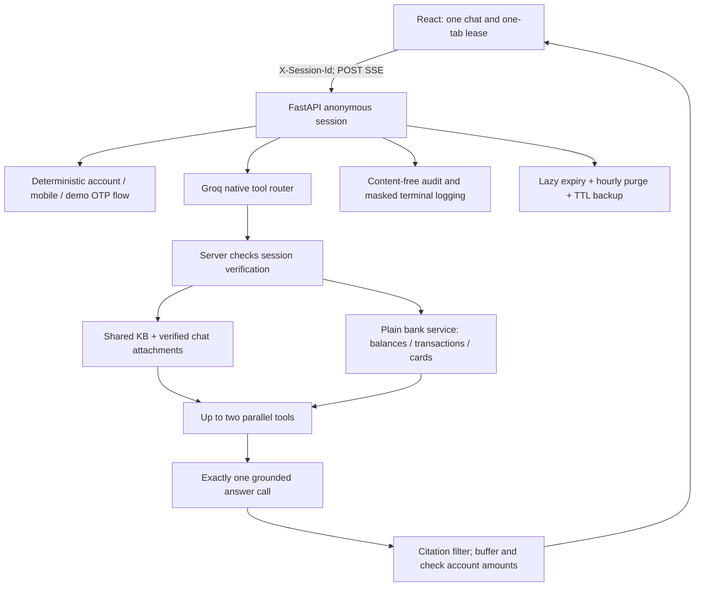

# Harbourline Bank Assistant

A local portfolio demo for a fictional Mumbai bank. Anyone can ask general banking questions without signing in. Questions about personal balances, transactions or cards start an in-chat account/mobile/demo-OTP verification flow.

Answers use only the five approved documents in `seed_docs/`, the verified customer's own bank records, and private files attached to the current chat. No internet search, CrewAI, money movement or R2 service flows are included. All fixtures are fictional. The existing shared documents still use their earlier demo branding; replacing that library belongs to R4.

## Architecture



The app database holds `sessions`, `messages`, `documents`, `chunks`, `verify_locks` and `audit_log`. The bank database holds `customers`, `accounts`, `cards`, `transactions`, `cheque_books` and `service_requests`. Only `session.verified.customer_id` authorizes bank reads. Tool argument schemas contain no identity fields. Handlers take `(ctx, args)` and the bank service has no router, LLM or agent dependency.

Account and mobile numbers are parsed by plain code and masked before user text reaches history, prompts or private-file embeddings. Shared KB text and authoritative monetary tool results stay unchanged. Six-digit values are masked only in the OTP step; elsewhere they can be pincodes, references or amounts. Real OTP delivery is deliberately unimplemented; `OTP_MODE=real` raises `NotImplementedError` at the provider seam.

## Setup in PowerShell

Install Python 3.12+, uv, and Node.js LTS. Configure your own Atlas, Groq and Gemini access locally:

```powershell
Set-Location C:\Projects\doctrag
uv sync
if (-not (Test-Path -LiteralPath .env)) {
    Copy-Item -LiteralPath .env.example -Destination .env
}
notepad .env
```

Supply `GROQ_API_KEY`, `GEMINI_API_KEY` and `MONGODB_URI`. The example contains placeholders only. Set model names to `openai/gpt-oss-120b` and `openai/gpt-oss-20b`. Empty `BANK_MONGODB_URI` uses `MONGODB_URI`; bank runtime credentials can be read-only, while seeding needs bank write/index privileges. Keep `CORS_ORIGINS` as explicit trusted origins.

Remove obsolete `JWT_SECRET`, `ACCESS_TOKEN_MINUTES` and `RETENTION_DAYS` from your local configuration. The app no longer uses them. Never commit `.env` or paste its contents into reports.

R1 settings and defaults are in `app/config.py` and `.env.example`:

| Setting | Default | Purpose |
| --- | --- | --- |
| SESSION_IDLE_WIPE_MINUTES | 30 | Wipe inactive chat and private files |
| VERIFY_IDLE_MINUTES | 10 | Verification idle expiry |
| VERIFY_MAX_MINUTES | 30 | Verification hard expiry |
| VERIFY_MAX_TRIES | 3 | Wrong pairs before lock/reset |
| VERIFY_LOCK_MINUTES | 15 | Account-hash lock across sessions |
| CHAT_RATE_PER_MINUTE | 6 | Per-session chat window |
| CHAT_RATE_PER_IP_PER_MINUTE | 20 | Separate direct-peer chat window |
| VERIFY_RATE_PER_IP_PER_MINUTE | 10 | Separate verification-attempt window |
| OTP_MODE | demo | Any six ASCII digits; real delivery unavailable |
| OTP_VALID_MINUTES | 5 | Demo OTP validity |
| LOG_SHOW_SENSITIVE | false | Reserved; never disables credential masking |
| LOG_FULL_PROMPTS | false | Reserved for later logging work; currently unused |

IPs come only from `request.client.host`. Run uvicorn with `--no-proxy-headers` so forwarded headers cannot change that value. Use one serving worker: chat/verification IP windows and state-transition locks are process-local. Account failure counts and locks live in Mongo and survive restart/New chat.

## Upgrade from the password-based demo

Stop the old server first. The optional migration previews retired data; `--apply` removes the old users collection, legacy user-owned sessions/messages/private files, and raw historical session ids in audit records. It preserves shared KB content and new anonymous sessions. Review the preview before applying:

```powershell
Set-Location C:\Projects\doctrag
uv run python -m scripts.migrate_r1
# Only after reviewing the preview:
uv run python -m scripts.migrate_r1 --apply
```

Neither command was run by the coding agent. The bank seed only upserts its own fixed fixture ids; it does not delete unrelated or older bank records. Use a fresh `BANK_DB_NAME` if you want a bank database containing exactly these ten fixtures.

## Seed the fictional bank and documents

These commands access your configured services; run them yourself:

```powershell
Set-Location C:\Projects\doctrag
uv run python -m scripts.seed_kb
uv run python -m scripts.seed_bank
```

There is no `seed_users` step. `seed_bank` reads reviewed JSON in `seed_data/bank/` and upserts stable keys. Regenerate those files without any keys or database access:

```powershell
uv run python -m scripts.generate_bank_data
```

The generator fixes the random seed and dates. Each account balance is the sum of its signed integer transactions; running balances are also stored. Currency is INR. Most accounts have 40 transactions; the new account has 2 and the senior fixture has 180.

| Customer | Account for verification | Registered mobile | Scenario |
| --- | --- | --- | --- |
| CUST-001 | 880000001001 | 9000000101 | Savings and active debit card |
| CUST-002 | 880000002001 | 9000000102 | Savings and current accounts |
| CUST-003 | 880000003001 | 9000000103 | Savings plus credit card |
| CUST-004 | 880000004001 or 880000004002 | 9000000104 | Two savings accounts |
| CUST-005 | 880000005001 | 9000000105 | Blocked debit card |
| CUST-006 | 880000006001 | 9000000106 | Cheque-book ineligible |
| CUST-007 | 880000007001 | 9000000107 | Incomplete KYC |
| CUST-008 | 880000008001 | 9000000108 | Pending cheque-book request |
| CUST-009 | 880000009001 | 9000000109 | New account, little activity |
| CUST-010 | 880000010001 | 9000000110 | Senior, long history |

All names, addresses, accounts and contacts are fake. Before sharing the demo, check that no real bank uses the `HRBL0` IFSC prefix. Cheque-book and service-request rows are fixture data only; no service-write tools are added in R1.

## Atlas index

`seed_kb` or app startup creates a missing vector index. Existing indexes are not overwritten. In Atlas, open the app database's `chunks` collection, edit `chunks_vector_index` using `atlas/chunks_vector_index.json`, save, and wait for `READY`. It uses 768 dimensions/cosine and filters `doc_id`, `scope`, `session_id`. The previous index's extra `owner_id` filter is harmless during upgrade; the new code never queries it. An index with all three required filters works without an immediate rebuild.

Retrieval always prefilters ready document ids and the server-built scope. There is no unfiltered fallback. Private files are hidden from retrieval and file listings while verification is absent or expired. Private evidence from earlier assistant replies is also excluded from model history while unverified.

## Run the API and frontend

Backend terminal:

```powershell
Set-Location C:\Projects\doctrag
$env:CORS_ORIGINS = 'http://127.0.0.1:8000,http://localhost:8000,http://127.0.0.1:5173,http://localhost:5173'
uv run uvicorn app.main:app --reload --host 127.0.0.1 --port 8000 --no-proxy-headers
```

Frontend development terminal:

```powershell
Set-Location C:\Projects\doctrag\frontend
npm ci
npm run dev
```

Open `http://127.0.0.1:5173/app/`. Vite proxies `/sessions` and `/chat` to port 8000. Production build:

```powershell
Set-Location C:\Projects\doctrag\frontend
npm run build
Set-Location C:\Projects\doctrag
uv run uvicorn app.main:app --host 127.0.0.1 --port 8000 --no-proxy-headers
```

Open `http://127.0.0.1:8000/app/`. `/` still opens Swagger; `/docs`, `/redoc` and `/health` remain available.

## Public API contract

`POST /sessions` returns only `{session_id}`. Store this bearer secret in browser `localStorage`; send `X-Session-Id` on subsequent requests. An unknown, expired or wiped id returns 404. Path ids must match the header. The chat body contains only `message`, optional `attachment_ids`, and `stream`.

In Swagger, create a session, copy its id into each operation's `x-session-id` header, and choose `stream=false` for a JSON answer. The SSE mode emits `status`, `meta`, `token`, `done`, `error`; account-data answers arrive in one buffered token event. Sources include passage text, citations remain clickable, and account cards show server-formatted amounts. Raw HTML is disabled.

Try general questions before verification. A personal question starts account → registered mobile → demo OTP. Any six ASCII digits verify the matched pair. Cancel/stop/never mind cancels the flow. An unrelated question gets a normal response plus a fixed continuation line. Expired OTPs require `resend`. Wrong pairs use generic wording; three failures for the typed account hash lock it for 15 minutes across sessions, including nonexistent accounts.

Verification expires after 10 idle minutes or 30 total minutes. Only accepted chat activity refreshes activity; history reads, uploads and the browser-only tab heartbeat do not. The entire chat is wiped after 30 idle minutes. Same-customer re-verification preserves history/files. Different-customer verification keeps the session id but clears messages, files, chunks and pending question, sends `meta.clear_history=true`, and asks for a fresh question.

Files require verification. POST/GET `/sessions/{id}/attachments` use the session header; unverified access returns 403 with `detail.code=verification_required`. Default limits: 3 files per upload, 5 per chat, 5 MB per file, 150 chunks and 500 table rows. Formats: PDF, DOCX, PPTX, TXT, MD, CSV, TSV, XLSX. Selected files upload first, then ready ids accompany chat. Follow-up retrieval includes ready files in that same verified chat even without repeating ids.

New chat deletes the old session before creating a fresh one. A browser-only tab lease refreshes every 10 seconds and blocks other tabs while younger than 30 seconds. `BroadcastChannel` and storage events allow recovery when the first tab closes. This convenience lease is not server authorization; the random session bearer remains the access boundary.

## Tests and HTTP evaluation

```powershell
Set-Location C:\Projects\doctrag
uv run pytest -q
Set-Location C:\Projects\doctrag\frontend
npm test
npm run build
```

Tests disable dotenv before collection and fake Mongo, Groq and Gemini. They cover R1 verification, isolation, lockouts, expiry, masked history/logs/private embeddings, customer changes, tool gating, native router validation, full chat routes, prompt budgets, provider retry/concurrency, output checks, citations and frontend behavior. They do not prove live retrieval/model quality.

Only after you start the running API and seed it, run the HTTP-only evaluator yourself:

```powershell
Set-Location C:\Projects\doctrag
uv run python -m scripts.run_eval --interval-seconds 12
```

The runner imports no app internals or provider SDKs and never reads `.env`. Existing Alice/Bob case labels map to CUST-001/CUST-002 fixtures. Each personal/injection case verifies through HTTP, then makes its test request; bearer mismatch/unknown-bearer probes replace password-era cross-user ownership checks. Verification setup adds model calls, so expect several minutes. It prints category pass rates and failed questions/answers and writes `eval/results/<timestamp>.json` with latency. Raw session bearers and verification credentials are redacted. No evaluation was run by the coding agent.

## Free-tier limits and known limitations

Put your actual account quotas in the table below, using your Groq console and Google AI Studio. These are deliberately blank; local defaults are not provider quotas.

| Provider/model | Requests/minute | Tokens/minute | Daily limit | Checked on |
| --- | --- | --- | --- | --- |
| Groq answer model | fill in | fill in | fill in | fill in |
| Groq router model | fill in | fill in | fill in | fill in |
| Gemini embeddings | fill in | fill in | fill in | fill in |
| Atlas storage/index budget | fill in | n/a | fill in | fill in |

Normal data questions use one router call and at most one answer call. Up to two tools run in parallel; document retrieval adds an embedding call. Verification steps themselves use plain code. The router retries once for invalid output; provider rate handling permits one retry for waits of at most 10 seconds. Longer waits produce a friendly busy event. Local Groq concurrency defaults to 2. Token estimates use characters/4, 15% margin, 12 history messages/1500 tokens, 5000 passage characters, 700 answer tokens and a 5000-token prompt ceiling. Oldest history is dropped before lowest-ranked passages. No tokenizer dependency is added.

This remains a demo for one or two people. Rate windows/locks requiring process coordination assume one worker; IP limits reset on restart, account lockout data does not. Demo OTP proves no real possession and is unsuitable for real accounts. A stolen session bearer exposes its chat until wipe; localStorage has the usual XSS trade-off. There is no admin interface, money movement, real OTP, OCR or guided service flow. Uploaded text goes to Gemini for embeddings and retrieved passages to Groq: use fictional data only. Atlas indexing is eventually consistent. Phrase-based evaluation and character-based token estimates are approximate. The currency guard checks recognized amount copying, not every statement's meaning. Live provider/database behavior requires the manual checks below.

## Manual acceptance checks

1. Open the UI with no sign-in; ask a fee/minimum-balance question and open a citation passage.
2. Ask for your balance. Use CUST-001's account/mobile, then any six digits. Check the card and confirm raw inputs are absent from refreshed history and terminal/audit logs.
3. Ask for transactions, card status and a mixed document/account question; check only your customer's data and one buffered account answer.
4. Use a wrong mobile three times, then New chat and retry that account: the same generic lock message remains. Repeat with a nonexistent 12-digit account.
5. Test cancel at every step, unrelated questions, malformed OTP, OTP expiry and resend.
6. Upload before verification (403), then after verification; check processing/ready/failed chips, size/count limits, masked stored passages, citations and attachment follow-ups.
7. Wait verification expiry: private files are unavailable until re-verification. Re-verify the same customer and preserve history/files; verify a different customer and confirm the whole old conversation/files clear while the session id stays.
8. Open a second tab: it blocks without API traffic. Close the first tab and check recovery; stale leases should recover within 30 seconds.
9. New chat invalidates the old id. Thirty idle minutes wipe history/files; audit events survive. History refresh/heartbeat must not extend either idle clock.
10. Trigger the session/IP chat limits and verification-IP limit; check friendly retry timing. Check provider-busy events and confirm forwarded headers do not alter the direct-peer bucket.

## Groq GPT-OSS model defaults

Answers default to `openai/gpt-oss-120b`; routing defaults to `openai/gpt-oss-20b`.
Update GROQ_MODEL and GROQ_REWRITE_MODEL in your own local configuration if they still override these defaults; the coding agent did not read or edit that file.

GPT-OSS does not support parallel native tool calls. The router therefore makes one native `select_tools` call containing one or two validated selections; the server still runs their handlers in parallel and makes one answer call. Other configured models retain direct native tool selection. Both GPT-OSS requests use `reasoning_effort=low`, `include_reasoning=false`, and `max_completion_tokens`. Reasoning is not disabled and counts against the unchanged completion caps (router 250, answer ANSWER_MAX_TOKENS). No built-in browser/code tools are enabled. Live checks should include a document question, a verified balance question, and a mixed question; inspect audit tool events and confirm the answer is complete rather than truncated.

References: [Groq tool support](https://console.groq.com/docs/tool-use/overview), [GPT-OSS reasoning options](https://console.groq.com/docs/reasoning#gpt-oss-models), [API reference](https://console.groq.com/docs/api-reference).
