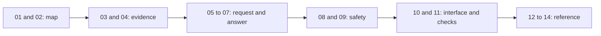

# Start here and plan your reading

## 1. What this part does

Abdul, start with the request path rather than trying to memorise all the libraries. This set connects the code you built to explanations you can defend in a demo or interview. It describes the current files, not a planned future system.
### Words used here

| Term | Plain meaning |
| --- | --- |
| RAG | Retrieval-augmented generation means finding relevant stored text and giving that text to a language model before asking for an answer. |
| LLM | A large language model predicts and produces text from supplied input; it is not a database or an identity checker. |
| API | An application programming interface is the agreed request and response contract between programs. |
| JWT | A JSON Web Token is a signed set of claims that this server uses as evidence of a login. |
| Embedding | An embedding is a numeric representation of text used for similarity search. |
| SSE | Server-sent events are named text events delivered over one HTTP response. |
| Mock | A mock is a controlled replacement for a real dependency used during a test. |
| Symbol | A symbol is a named code item, such as a function, class, constant or setting. |
| Mermaid | A text format that draws the flow diagrams shown in these documents. |

## 2. Where it lives

The explanation files live in docs/explained. The implementation lives in app, scripts, tests, eval, atlas, seed_docs and frontend. These folders serve different purposes: app handles requests, scripts perform explicit operator actions, tests check behavior, and frontend runs the browser interface.

| Document | Read it for | What you should be able to explain |
| --- | --- | --- |
| 00-index.md | Choose a reading order and learn what counts as evidence. | Explain the project without claiming live accuracy or real banking support. |
| 01-project-overview.md | Understand the three permitted sources, the model roles and all declared dependencies. | Name the component that owns each responsibility instead of saying the AI does everything. |
| 02-architecture-and-file-map.md | Locate every maintained source file and follow startup, shutdown and network boundaries. | Trace a browser request through FastAPI to the correct database or provider. |
| 03-ingestion-chunking-embedding.md | Follow file bytes through loaders, sections, chunks, embeddings and status updates. | Explain why table headers stay with values and why indexing can lose detail. |
| 04-retrieval-and-vector-search.md | Read the Atlas vector query, visibility filters, ready-document gate and score threshold. | Show why similarity ranking never replaces an ownership check. |
| 05-request-lifecycle-and-context.md | Inspect the actual router and answer inputs, history budgets, events and persistence order. | Describe what each model sees and what gets dropped when the prompt is too large. |
| 06-routing-and-tools.md | Study native tool calling, strict argument validation, server identity and plain handlers. | Explain how a model requests work without gaining database authority. |
| 07-answers-citations-output.md | Inspect fixed replies, the system prompt, citation cleanup and account amount checks. | Distinguish a valid reference number from proof that a sentence is correct. |
| 08-auth-sessions-security.md | Follow password verification, JWT checks, ownership, audit records and retention. | Defend isolation claims with actual query filters rather than the prompt alone. |
| 09-errors-limits-reliability.md | Map failures and exact messages to their handlers and budget controls. | Describe a safe partial result and avoid promising unlimited retries or availability. |
| 10-frontend.md | Follow React state, token storage, uploads, SSE parsing, citations and production hosting. | Explain the browser/server contract and why account cards disappear after a reload. |
| 11-testing-and-evaluation.md | Read test fixtures, external-service substitutes, the HTTP evaluator and coverage gaps. | Separate deterministic wiring tests from a live model-quality measurement. |
| 12-code-reference.md | Look up Python and TypeScript declarations, decorators, constants and private-helper groups. | Find a symbol by file and purpose without depending on stale line numbers. |
| 13-decision-log.md | Compare current implementation choices with plausible alternatives and their costs. | Give a reasoned answer while distinguishing evidence from inferred design rationale. |
| 14-glossary-and-find-it-fast.md | Look up technical terms, settings, models, collections, indexes and libraries. | Return from an unfamiliar name in an interview to the exact implementing symbol. |

## 3. How it works, step by step

### The project on one page

Lantern Demo Bank is a fictional bank assistant. A signed-in customer can ask about approved bank documents, that customer's own account data, and files attached to that customer's current chat. Those are the three allowed information sources. The assistant does not have a web-search tool. It cannot transfer money, block a card, file a dispute or approve a loan. The bank data is seeded demonstration data, not a connection to a real bank.

FastAPI accepts the browser's HTTP requests. It verifies the login, checks chat ownership and enforces the per-user request limit. A small Groq model selects at most two tools. Document questions use an embedding and Atlas Vector Search. Account questions use Python functions that read the bank database. The server combines those results and makes at most one logical answer-model call. A fixed greeting, refusal or no-result message skips that answer call, although routing still normally calls the smaller model.

The browser receives status, metadata, answer fragments and completion or error events. A document answer can appear gradually. An answer containing account data is collected and checked before its text is sent. The authoritative account card uses formatted strings returned by the bank service. History is saved after answer generation completes. This is not a database transaction across both saved messages, so an error during saving can still leave an incomplete pair.

The app database stores login users, sessions, messages, document records, chunks and audit events. A separate bank database stores fictional customers, accounts, transactions and cards. The authenticated user record links to the bank customer. The language model never chooses that link. This separation is the most useful security fact to explain first.

### Reading order

1. Read 01 and 02 to learn the boundary of the product and locate the modules. Draw the request path from memory before continuing.
2. Read 03 and 04 together. Ingestion creates searchable evidence; retrieval selects from that evidence. One cannot replace the other.
3. Read 05, 06 and 07 in sequence. Track one mixed question through planning, tools, prompt construction and output checks. Use the fee table's actual replacement fee of INR 200; do not copy a different amount from a mocked fixture.
4. Read 08 and 09 before presenting security or reliability claims. A signed token, an ownership filter and a prompt instruction solve different problems.
5. Read 10 while using the browser interface. Read 11 while opening the test files. Use 12 and 14 as references rather than reading every row aloud.
6. Finish with 13. Rehearse each decision as choice, because, alternative and cost. Say when the reason is inferred from the implementation rather than recorded by its author.

### Three practical study sessions

For a first session, spend time on a document question. Find the seeded fee row, locate its loader path, inspect retrieval filtering and find the citation button. Explain that a returned citation identifies supplied text but does not prove that the model interpreted it correctly.

For a second session, use a balance question. Start at the verified user record, follow the customer value into ToolContext, and stop at the bank query. Then follow the result back to the account card. Do not describe a customer identifier in a tool argument, because that field is deliberately absent.

For a third session, use a failure. Read a test for a foreign session, an invalid model argument or a provider limit. State the exact layer that catches the error, whether an answer call happens, what the browser receives and whether any completed history is saved. This makes a stronger interview explanation than listing package names.

Read from the product boundary toward implementation details, then return to the reference files when a name is unfamiliar.

## 4. Key pieces

| Name | Kind | File | What it does | Why it exists |
| --- | --- | --- | --- | --- |
| get_current_user | function | app/auth/security.py | Verifies the token and reloads the active user record. | It gives every protected request a server-verified identity rather than accepting identity supplied by a model. |
| run_chat | function | app/routers/chat.py | Coordinates history, planning, tool results, answer filtering and message saves. | It makes the order of a turn visible in one place for a small project. |
| plan_turn | function | app/services/router.py | Selects validated tools or a fixed-reply kind. | It separates deciding what data is needed from writing the final answer. |
| ToolContext | class | app/tools/registry.py | Carries verified user, customer and session values to handlers. | It keeps identity outside every model-visible argument schema. |
| search | function | app/services/retrieval.py | Builds a scoped vector query over ready documents. | It combines relevance ranking with an explicit privacy boundary. |
| prepare_prompt | function | app/services/prompting.py | Fits history and evidence into an estimated prompt budget. | It limits input size before a provider call consumes quota. |
| AccountCards | function | frontend/src/AccountCards.tsx | Renders the display blocks returned with account results. | It shows server-provided amounts even when generated wording is replaced. |
| HTTPOnlyRunner | class | scripts/run_eval.py | Tests the running API without importing application services. | Its tests can survive a later change to the internal agent layer. |

## 5. Decisions

| Decision | Because | Alternative not used | Trade-off |
| --- | --- | --- | --- |
| Explain from current source | Source files show the behavior the owner must demonstrate. | Treat DESIGN as proof of completed behavior. | Differences must be stated even when they reveal limitations. |
| Use a worked request | A concrete question links unfamiliar names to observable steps. | Memorise the full file tree before running any example. | One example does not exercise every branch; use the test map too. |
| Keep verification claims separate | Mocked tests and live services provide different evidence. | Call all tests an end-to-end live validation. | Some claims must remain not tested live. |
| Keep secrets outside study notes | The explanation needs setting names, not real credentials. | Paste the local environment file into examples. | A reader still has to configure their own services to run live checks. |

## 6. What can go wrong

The main study error is confusing a plan with running behavior. Differs from DESIGN.md: saved messages do not include account cards; live citation metadata contains an excerpt, and historical sources omit even that excerpt. The frontend explains this rather than reconstructing missing evidence.

Another error is calling this bank-grade production security. The code has owner filters, read-only tools, bounded requests and audit events, but those controls do not establish a compliance certification or prove that an answer is correct. Provider quotas, credentials, cluster state and deployment hardening are not confirmed from the code. No live evaluation was run for this documentation task.

A third error is treating a successful model response as a successful stored turn. Generation, client delivery and database saving are separate operations. Read their order in run_chat before promising exactly-once delivery or atomic persistence; neither guarantee is implemented here.

## 7. How to see it working

Use the existing README for commands, but verify names against the implementing setting. For example, the attachment endpoint uses Settings.user_upload_max_mb; the legacy Settings.max_upload_mb is not its limit. The frontend limit must match the user-specific setting.

For a safe study check, open tests/test_phase6_integration.py and read test_mixed_answer_full_http_one_model_call. It supplies fake provider output, exercises the HTTP path and checks that one answer receives both sources. Read test_request_cannot_supply_identity in tests/test_phase2.py for rejected request fields. These test names are evidence of checked contracts, not a live score.

Before an interview, practise a two-minute account question and a five-minute document question. Keep the code reference available for exact symbol names. If asked a provider's current context window or free-tier quota, answer “not confirmed from the code” rather than inventing a number. If asked what was executed now, say only the documentation inventory and reference checks; the earlier project handoff records implementation checks separately.

## 8. Check yourself

1. **What makes this RAG rather than a model answering alone?** The server retrieves stored passages and supplies them as evidence before generation.

2. **Where does the account identity come from?** The active user record loaded from a verified login token, then a server-built ToolContext.

3. **Does a greeting use no model at all?** It normally uses the router model, then a fixed reply avoids the answer model.

4. **What should you say about a missing live result?** Not tested live; explain what the deterministic tests actually establish.

5. **How do you find a declaration quickly?** Use document 12 for symbols and document 14 for settings, models, collections and libraries.
