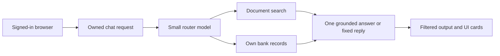

# Project overview

## 1. What this part does

Lantern answers questions using approved documents, a signed-in customer's own bank records and that customer's chat attachments. It is a demonstration with fictional users and money. It refuses questions outside that boundary and cannot perform bank operations.
### Words used here

| Term | Plain meaning |
| --- | --- |
| RAG | Retrieval-augmented generation means finding stored evidence and giving it to a text model before generation. |
| Embedding | An embedding is a list of numbers representing text for similarity matching. |
| Vector | A vector is an ordered list of numeric coordinates. |
| Chunk | A chunk is one bounded piece of extracted document text stored for retrieval. |
| Token | A token is a model-specific unit of text; this app estimates counts using characters divided by four. |
| JWT | A JSON Web Token is a signed set of login claims sent with authenticated requests. |
| Decorator | A Python decorator is a function applied to another declaration to add registration or behavior. |
| Dependency injection | Dependency injection means the framework supplies a declared dependency, such as a verified user, before calling an endpoint. |
| Pydantic | Pydantic validates structured Python data against declared field types and rules. |
| Async/await | Async/await lets a task pause for an operation while the event loop runs other waiting tasks. |
| Fixture | A pytest fixture is reusable test setup requested by name by a test. |
| Mermaid | A text format that draws the flow diagrams shown in these documents. |

## 2. Where it lives

The server enters through app/main.py. The request contract is in app/schemas.py. The chat controller is app/routers/chat.py; routing and answer-provider calls are in app/services/router.py and app/services/llm.py. The plain bank functions live in app/bank/service.py. Browser entry and state live in frontend/src/main.tsx and frontend/src/App.tsx. The five approved demo documents live in seed_docs.

The dependency tables below cover every direct Python dependency and every direct npm dependency declared by the project. They also identify Pydantic because application code imports it directly even though pyproject obtains it through other packages. Lockfiles contain additional transitive packages; these tables do not pretend those packages are all independent application choices.

## 3. How it works, step by step

1. The user signs in through the React login form. The API accepts form data, verifies the password hash and returns a signed access token. Later requests send that token in an Authorization header.
2. The user creates or opens a chat. A session is a stored conversation record belonging to a user; it is not the JWT itself. A foreign session produces 404 even if its identifier exists.
3. Suppose Alice asks, “What is the debit card replacement fee?” The browser submits the existing session, message text and ready attachment identifiers to the POST chat endpoint. It does not submit a customer identity.
4. The server checks ownership, attachment visibility and the per-user request window. It loads bounded conversation history and asks the small router model which data tools are needed.
5. A valid search_documents call contains a search query. The handler adds the verified owner and session. Retrieval finds ready shared documents plus this owner's files in this chat. It embeds the query, runs vector search and rejects scores below the configured threshold before generation.
6. The actual seed_docs/fee_schedule.csv contains a debit card replacement fee of 200 INR. The answer model receives selected text with numbered source labels, not the entire file library. A possible answer is “The replacement fee is INR 200 [1].” That wording is illustrative, not a live model result.
7. CitationFilter converts supported citation formats to valid source numbers. The server sends answer fragments, then saves the completed text and emits completion. The browser turns the reference into a button that opens the supplied file excerpt.
8. If Alice instead asks for her balance, the bank handler reads only her customer records. The account display uses the server's formatted balance string. Generated account wording is buffered and checked before release; the model never calculates the authoritative balance.

A mixed question can select two tools and still use one logical answer call. Two tools are not two independent chatting agents. The tools return data; the orchestrator combines that data for one answer prompt. There is no CrewAI implementation, agent delegation layer or separate bank HTTP service in the current code.

The router selects evidence, while server code controls identity and final output delivery.

## 4. Key pieces

### Models and services

| Name | Role | Implementing file and call name | What travels there |
| --- | --- | --- | --- |
| openai/gpt-oss-20b | Router model default | app/services/router.py — plan_turn via client().chat.completions.create | Planner instructions, short history, current message, has_files flag and argument schemas. |
| openai/gpt-oss-120b | Answer model default | app/services/llm.py — stream_answer via stream_groq | System instructions, fitted history, current question, selected passages and optional own account data. |
| gemini-embedding-001 | Embedding model default | app/services/embeddings.py — _embed_batch via aio.models.embed_content | Header-enriched chunks during ingestion; rewritten search query during retrieval. |
| Groq | Hosted model API | app/services/llm.py — AsyncGroq | Text inputs and generated text/tool-call outputs; selected text can include private demo account data. |
| Google Gemini | Hosted embedding API | app/services/embeddings.py — genai.Client | Extracted text becomes numeric vectors; raw source-file bytes are parsed locally. |
| MongoDB Atlas | Hosted application and bank storage | app/db.py and app/bank/db.py — AsyncMongoClient | Scoped reads/writes, vector queries, documents, messages and fictional account records. |
These are code defaults. Effective model overrides, current provider quotas, actual available context windows and live availability are not confirmed from the code. No provider was called while writing this set.

### Python and npm libraries

| Group | Library | File | Name used there | Purpose | Why it fits |
| --- | --- | --- | --- | --- | --- |
| Python | fastapi | app/main.py | FastAPI; APIRouter; Depends | Defines HTTP endpoints, validation integration and injected authentication. | Keeps the request contract visible through Swagger for a small team. |
| Python | uvicorn[standard] | pyproject.toml | uvicorn app.main:app | Runs the ASGI application; ASGI is the async server-to-Python application contract. | Supplies the server process rather than requiring handwritten socket handling. |
| Python | pydantic-settings | app/config.py | BaseSettings; SettingsConfigDict | Loads typed configuration from environment variables and configured dotenv input. | Centralises defaults and rejects invalid validated settings before serving requests. |
| Python | pydantic | app/schemas.py | BaseModel; Field; field_validator | Validates requests, responses, settings fields and model tool arguments. | It is used directly but supplied through declared dependencies, not listed separately in pyproject. |
| Python | python-dotenv | app/config.py | BaseSettings dotenv integration | Supports dotenv configuration through pydantic-settings, with no direct dotenv call here. | Keeps local setup in one place; a separate direct import is not confirmed. |
| Python | pymongo | app/db.py | AsyncMongoClient; SearchIndexModel | Provides async collection access and Atlas search-index management. | One driver handles document records, histories and vector search without another database layer. |
| Python | certifi | app/db.py | certifi.where | Supplies the certificate-authority bundle path to Mongo clients. | The clients verify TLS certificates instead of disabling certificate checks. |
| Python | groq | app/services/llm.py | AsyncGroq | Calls the router and answer models; RateLimitError is handled in groq_runtime. | Separate model roles keep planning smaller while sharing the concurrency guard. |
| Python | google-genai | app/services/embeddings.py | genai.Client; types.EmbedContentConfig | Calls Gemini embeddings asynchronously with task type and output dimension. | Retrieval needs vectors; it does not use Gemini as the answer model. |
| Python | langchain-text-splitters | app/services/chunking.py | RecursiveCharacterTextSplitter | Splits prose using paragraph, line, sentence and word separators. | It reuses a focused splitter without introducing a LangChain agent layer. |
| Python | pdfplumber | app/services/loaders.py | pdfplumber.open | Extracts PDF tables and text outside detected tables. | Header-preserving tables carry meaning that flat text extraction can lose. |
| Python | pypdf | app/services/loaders.py | PdfReader | Supplies the simpler plain-text PDF fallback. | A PDF extraction failure need not prevent readable text from being used. |
| Python | python-docx | app/services/loaders.py | Document; Table; Paragraph | Reads Word paragraphs, styles and tables in body order. | It preserves headings and table structure instead of flattening the document indiscriminately. |
| Python | python-pptx | app/services/loaders.py | Presentation; MSO_SHAPE_TYPE; PP_PLACEHOLDER | Reads slide text, tables, chart data, notes and useful image alt text. | Slides need ordering and location labels for meaningful later citations. |
| Python | openpyxl | app/services/loaders.py | openpyxl.load_workbook | Reads visible XLSX sheets in read-only, cached-value mode. | It supports tabular files without spreadsheet automation or a running Excel process. |
| Python | pwdlib[argon2] | app/auth/security.py | PasswordHash.recommended | Hashes and verifies passwords using the configured recommended Argon2 implementation. | Stores verification hashes instead of recoverable plaintext passwords. |
| Python | pyjwt | app/auth/security.py | jwt.encode; jwt.decode | Signs HS256 access tokens and verifies required claims. | The project can authenticate requests without a server-side session-token collection. |
| Python | python-multipart | app/routers/attachments.py | File; UploadFile form parsing | Supports multipart uploads and login form parsing inside FastAPI. | The browser can submit real files and Swagger can send OAuth2 form credentials. |
| Python | sse-starlette | app/routers/chat.py | EventSourceResponse | Encodes generator events as an SSE response. | The API can stream named events while retaining a POST request body. |
| Python | httpx | scripts/run_eval.py | httpx.Client; httpx.MockTransport | Calls the running API and supplies HTTP-only runner test substitutes. | Evaluation does not need to import the server or talk directly to Mongo. |
| Python dev | pytest | tests/conftest.py | pytest.fixture; pytest.mark.parametrize | Discovers tests and injects reusable setup and monkeypatching. | Isolation rules can be checked without spending provider quota. |
| Python dev | pytest-asyncio | pyproject.toml | development dependency | Adds async pytest support; current tests commonly call asyncio.run through helpers. | Do not claim the plugin drives every async test; many are normal sync test functions. |
| npm | react | frontend/src/App.tsx | useState; useEffect; useRef; useSyncExternalStore | Builds UI components and keeps rendering aligned with state. | Small local state is sufficient here without adding an application-wide state library. |
| npm | react-dom | frontend/src/main.tsx | createRoot | Mounts React into the root HTML element. | Separates React components from the browser document rendering implementation. |
| npm | react-markdown | frontend/src/Answer.tsx | ReactMarkdown | Turns Markdown into React elements with raw HTML skipped. | Model text is displayed without handing it directly to HTML injection APIs. |
| npm | remark-gfm | frontend/src/Answer.tsx | remarkGfm | Adds GitHub-flavored Markdown support, including tables. | Bank fees and transactions are easier to compare in table form. |
| npm | unified | frontend/src/Answer.tsx | Plugin type | Types the custom citation transformation plugin; the import is type-only. | A typed syntax-tree transform avoids replacing citation-like text inside code. |
| npm dev | typescript | frontend/tsconfig.json | tsc -b | Checks types, unused declarations and strict component/API contracts. | It catches frontend mistakes before bundling, although it cannot validate live JSON at runtime. |
| npm dev | vite | frontend/vite.config.ts | defineConfig; vite commands | Runs the local dev proxy and produces static production assets. | The Python deployment can serve the output without a second production web server. |
| npm dev | @vitejs/plugin-react | frontend/vite.config.ts | react | Adds React transformation support to Vite. | It keeps JSX development and bundling inside the existing Vite toolchain. |
| npm dev | vitest | frontend/src/api.test.ts | describe; it; expect; vi | Runs frontend tests and stubs browser fetch. | Stream parsing and error messages can be exercised with deterministic responses. |
| npm dev | jsdom | frontend/vite.config.ts | test.environment | Provides a browser-like document for component tests. | Component behavior can be checked without treating simulated layout as a real browser measurement. |
| npm dev | @testing-library/react | frontend/src/App.test.tsx | render; screen; waitFor | Renders components and finds visible controls by roles and labels. | Tests focus on user behavior rather than private state variable names. |
| npm dev | @testing-library/user-event | frontend/src/App.test.tsx | userEvent.setup; userEvent.click | Simulates typing, clicking and file selection. | It exercises the same event handlers the interface connects to real controls. |
| npm dev | @testing-library/jest-dom | frontend/src/test-setup.ts | jest-dom/vitest matchers | Adds readable assertions such as visibility and enabled-state checks. | Failures describe a UI contract instead of only comparing raw markup. |
| npm dev | @types/react; @types/react-dom | frontend/src/main.tsx | StrictMode; createRoot type declarations | Provides editor/compiler types for React and browser mounting. | These are development declarations, not extra browser services. |
| npm dev | @types/mdast | frontend/src/Answer.tsx | Root; RootContent | Types Markdown syntax-tree nodes used by the citation plugin. | It makes the custom tree walk checkable during TypeScript compilation. |

### Python standard library and directly imported dependency namespaces

| Standard-library module | Example file/import | Purpose |
| --- | --- | --- |
| __future__ | app/services/loaders.py — from __future__ import annotations | Defers annotation evaluation in the loader module. |
| argparse | scripts/run_eval.py — import argparse | Parses evaluator command-line options. |
| ast | tests/test_eval_runner.py — import ast | Parses source in boundary/import tests without executing it. |
| asyncio | app/auth/throttle.py — import asyncio | Schedules tasks, waits, locks, semaphores and async test coroutines. |
| codecs | app/services/loaders.py — import codecs | Recognizes UTF byte-order marks while decoding source files. |
| collections | app/auth/throttle.py — from collections import deque | Supplies deques, counters, default dictionaries and async collection interfaces. |
| concurrent | tests/test_phase5.py — from concurrent.futures import ThreadPoolExecutor | Supplies worker threads for limiter-concurrency tests. |
| contextlib | app/auth/throttle.py — from contextlib import asynccontextmanager | Provides managed lifespan/slot contexts, generator closing and cancellation suppression. |
| copy | tests/test_phase2.py — import copy | Copies fake database rows so tests do not mutate shared fixture inputs accidentally. |
| csv | app/services/loaders.py — import csv | Reads delimited source tables and the fee-fact test. |
| dataclasses | app/services/loaders.py — from dataclasses import dataclass, field | Builds internal section/tool/prompt data containers and inspects their fields. |
| datetime | app/auth/security.py — from datetime import datetime, timedelta, timezone | Creates UTC timestamps, expiry arithmetic and source cell date strings. |
| email | app/services/groq_runtime.py — from email.utils import parsedate_to_datetime | Parses HTTP date-form retry timing. |
| functools | app/config.py — from functools import lru_cache | Caches settings and provider clients. |
| hashlib | app/services/document_store.py — import hashlib | Computes scoped upload SHA-256 digests. |
| importlib | tests/test_phase2.py — import importlib.util | Loads real database source separately from a test stub. |
| inspect | tests/test_phase4b.py — import inspect | Checks handler signatures in boundary tests. |
| io | app/services/loaders.py — import io | Wraps file bytes/text for parser libraries. |
| json | app/routers/chat.py — import json | Serializes prompts/events and parses model arguments/evaluation files. |
| logging | app/routers/chat.py — import logging | Writes safe operational diagnostics by exception type. |
| math | app/services/embeddings.py — import math | Computes vector lengths, finite checks and rounded retry timing. |
| mimetypes | scripts/seed_kb.py — import mimetypes | Guesses seeded source content types. |
| os | tests/conftest.py — import os | Supplies controlled test environment values without opening dotenv secrets. |
| pathlib | app/main.py — from pathlib import Path | Resolves source/build paths and source filename extensions. |
| random | tests/test_citations.py — import os, random, sys | Generates repeatable stream-split test inputs. |
| re | app/services/citations.py — import re | Recognizes citations, formats, amount strings and evaluator text patterns. |
| sys | tests/conftest.py — import sys | Manages test import paths and application-module substitutes. |
| threading | app/services/rate_limits.py — from threading import Lock | Protects local rate-limit reservations across threads. |
| time | app/auth/throttle.py — import time | Measures monotonic windows and evaluator timings. |
| traceback | app/routers/chat.py — import traceback | Extracts safe traceback locations without logging exception messages. |
| types | tests/test_chat.py — import types | Constructs fake modules and simple provider/database response objects. |
| typing | app/auth/router.py — from typing import Annotated, Literal | Declares literals, annotated dependencies and callable/result types. |
| urllib | scripts/run_eval.py — from urllib.parse import quote | Safely encodes evaluator session identifiers in HTTP paths. |
| uuid | app/services/memory.py — from uuid import uuid4 | Constructs session UUIDs and validates stable demo-user IDs. |

| Imported dependency namespace | Owning package | Example file and name | Purpose |
| --- | --- | --- | --- |
| bson | pymongo | app/services/attachments.py — ObjectId; InvalidId | Converts/validates internal Mongo document identifiers; it is not an independently declared bson dependency. |
| starlette | FastAPI dependency | app/auth/security.py — run_in_threadpool | Runs synchronous password verification outside the async request event loop; other Starlette behavior underlies FastAPI. |

## 5. Decisions

| Decision | Because | Alternative not used | Trade-off |
| --- | --- | --- | --- |
| Use distinct planning and answer models | Planning only needs a small tool decision and can be capped at 250 output tokens. | Use the larger answer model for every planning step. | Two normal model roles still consume requests; smaller does not mean free. |
| Retrieve before writing facts | The product permits only supplied evidence and owned account data. | Let the model supply facts from general knowledge. | Missing retrieval means the assistant must admit missing information. |
| Use a separate bank database | Bank records have a distinct access boundary and can use read-only credentials. | Put all collections behind one undifferentiated database credential. | Deployment still has to configure the permissions correctly. |
| Keep focused libraries | Loaders and text splitters solve parsing tasks without an agent framework. | Introduce a broad agent framework during these phases. | The application owns orchestration and must test it directly. |
These are explanations of the implemented choices and their fit to a small, quota-limited demo. A historical comparison or benchmark of every unused alternative is not confirmed from the code.

## 6. What can go wrong

A language model may choose the wrong tool, miss a document or phrase a correct fact poorly. Strict arguments prevent it from supplying foreign identity fields, but do not prove that its route is semantically ideal. Empty retrieval uses a fixed no-result message. Partial tool failure preserves successful evidence and reports missing data. A fully failed data turn receives a fixed unavailable reply.

Differs from DESIGN.md: messages do not persist account cards, and public source metadata removes complete passage text. The browser therefore cannot restore a full historical source passage or account card after a reload. A source reference is an evidence pointer, not a guarantee of correctness. Seed data, test fixtures and live returned values must not be confused; some tests deliberately use different fictional fees to test plumbing.

## 7. How to see it working

In Swagger, authenticate, create a session and send the replacement-fee question with stream set to false for a readable JSON response. Check answer, cited, sources and plan. Ask for a balance and check account_cards plus the absence of document citations for account-only facts. These operations contact your configured services and were not executed for this documentation task.

For deterministic evidence, open tests/test_phase6_integration.py and read test_document_answer_full_http, test_account_answer_full_http_uses_verified_identity and test_mixed_answer_full_http_one_model_call. Their fixtures replace external storage and provider boundaries. They establish request wiring and isolation under supplied outputs, not live model intelligence.

## 8. Check yourself

1. **Does Gemini write the answers?** No. Gemini supplies embeddings; Groq hosts the router and answer models.

2. **Why does the bank tool not accept an account identifier?** The server resolves the caller through the verified customer record and returns only owned results.

3. **What does a citation establish?** It identifies a supplied source number; semantic support still needs inspection.

4. **What costs a document question normally incur?** A router call, a query embedding when ready documents exist, vector search, and at most one answer call, before bounded retries.

5. **Are all listed packages runtime browser code?** No. TypeScript, type declarations, test packages and build tools are development dependencies.
