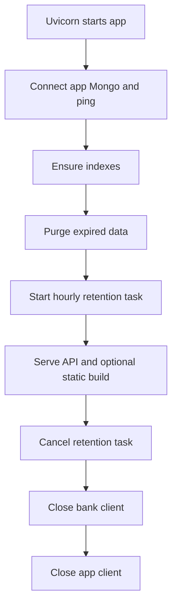

# Architecture and file map

## 1. What this part does

The browser and server are separate programs during development and one deployed application after building. The server owns identity, data access, evidence selection and model calls. Folder boundaries make those responsibilities visible, although this is one Python application rather than several independent services.
### Words used here

| Term | Plain meaning |
| --- | --- |
| HTTP | Hypertext Transfer Protocol carries a request method, path, headers and body, followed by a response. |
| SSE | Server-sent events deliver named text events over one long-lived HTTP response. |
| CORS | Cross-Origin Resource Sharing is the browser rule that checks which origins may read cross-origin responses. |
| Origin | An origin is the combination of scheme, hostname and port. |
| ASGI | ASGI is the interface through which an async Python web server calls a web application. |
| Async/await | Async/await lets a function pause during awaited work without blocking the event loop with that wait. |
| Lifespan | A lifespan function runs setup before serving requests and cleanup after serving stops. |
| Background task | A background task runs outside the immediate response-producing path; it is not automatically a durable job. |
| Decorator | A decorator applies additional behavior or registration to a Python declaration. |
| Dependency injection | Dependency injection supplies declared inputs such as a verified current user before an endpoint runs. |
| Index | An index is a stored database structure used to accelerate or enforce a type of lookup. |
| TLS | Transport Layer Security encrypts a connection and supports server-certificate verification. |
| Mermaid | A text format that draws the flow diagrams shown in these documents. |

## 2. Where it lives

### Maintained file tree

This table is the maintained source tree under the requested folders, with one entry per file. Generated caches, dependency installations, production bundles and local evaluation result reports are excluded because they are outputs rather than maintained source. A Python __init__ file can be empty and still make its directory importable. The frontend test files are included because they live under frontend/src.

| File | Responsibility |
| --- | --- |
| app/__init__.py | Marks this directory as a Python package; contains no request handler or data pipeline. |
| app/auth/__init__.py | Marks this directory as a Python package; contains no request handler or data pipeline. |
| app/auth/router.py | Accepts form login and returns the verified current-user summary. |
| app/auth/security.py | Hashes passwords, issues/checks JWTs and loads active user identity. |
| app/auth/throttle.py | Serializes login checks and tracks username failure windows in process memory. |
| app/bank/__init__.py | Marks this directory as a Python package; contains no request handler or data pipeline. |
| app/bank/db.py | Lazily creates a separate bank client and defines bank indexes for seeding. |
| app/bank/service.py | Reads owned balances, recent transactions and card status and formats INR without floats. |
| app/config.py | Declares typed configuration defaults and validators, and caches one Settings object. |
| app/db.py | Owns the app Mongo client, collection accessors and ordinary/vector index setup. |
| app/main.py | Creates FastAPI, registers routes and CORS, mounts a built frontend and owns startup/shutdown cleanup. |
| app/routers/__init__.py | Marks this directory as a Python package; contains no request handler or data pipeline. |
| app/routers/attachments.py | Accepts limited multipart uploads, schedules scoped ingestion and lists owned attachment status. |
| app/routers/chat.py | Coordinates a complete chat turn and exposes session creation, listing, history and deletion. |
| app/schemas.py | Defines HTTP request and response models, including chat text and attachment limits. |
| app/services/__init__.py | Marks this directory as a Python package; contains no request handler or data pipeline. |
| app/services/attachments.py | Resolves owned document IDs and yields bounded readiness-wait events. |
| app/services/audit.py | Writes event names, identities, outcomes, durations and count summaries without message contents. |
| app/services/chunking.py | Splits prose with overlap while preserving pre-sized tables and short slides where possible. |
| app/services/citations.py | Normalizes supported citation styles, removes invalid references and strips old history citations. |
| app/services/document_store.py | Registers scoped file hashes, reserves chat upload slots and handles ingestion/delete races. |
| app/services/embeddings.py | Calls Gemini document/query embeddings in batches with normalization and bounded retries. |
| app/services/groq_runtime.py | Shares Groq concurrency slots and retries short rate limits without duplicating emitted text. |
| app/services/ingestion.py | Loads, chunks, embeds and stores extracted evidence, then records ready or failed status. |
| app/services/llm.py | Stores the grounded-answer prompt, fixed replies and cached Groq answer client. |
| app/services/loaders.py | Parses eight supported file extensions into located text sections and extraction warnings. |
| app/services/maintenance.py | Purges inactive owned data and marks documents stuck in processing as failed. |
| app/services/memory.py | Stores owner-filtered chat sessions/messages, refreshes file expiry and deletes chat-owned data. |
| app/services/output_guard.py | Checks recognized currency-like answer strings against account display amounts and retrieved text. |
| app/services/prompting.py | Builds bounded history, delimited evidence and fitted answer prompts using character estimates. |
| app/services/rate_limits.py | Reserves per-user sliding-window chat slots using a process-local lock. |
| app/services/retrieval.py | Combines a visibility filter, ready-document IDs and an Atlas vector search pipeline. |
| app/services/router.py | Requests native tool calls, validates them, caps selected calls and falls back to document search. |
| app/services/textfix.py | Normalizes problematic hyphens, spaces and zero-width characters before Markdown display. |
| app/tools/__init__.py | Marks this directory as a Python package; contains no request handler or data pipeline. |
| app/tools/account_tools.py | Registers three plain account handlers and the optional transaction-type/limit argument model. |
| app/tools/document_tools.py | Registers scoped document search and rejects blank model-supplied queries. |
| app/tools/registry.py | Defines server identity context, strict arguments, tool specifications, schemas and audited execution. |
| atlas/chunks_vector_index.json | Defines the 768-dimensional cosine vector field and four permitted filter fields. |
| eval/cases.jsonl | Contains 32 structured document, account, scope, injection and ownership evaluation cases. |
| frontend/.env.example | Documents public frontend upload/text limit defaults without credentials. |
| frontend/index.html | Provides page metadata and the root element used by React. |
| frontend/package-lock.json | Locks the resolved npm dependency graph for repeatable npm ci installs. |
| frontend/package.json | Declares direct browser/build/test dependencies and npm commands. |
| frontend/src/AccountCards.tsx | Displays server-formatted balances, transaction rows and masked card status. |
| frontend/src/Answer.test.tsx | Checks safe Markdown, citation clicks, missing excerpts and exact account display strings. |
| frontend/src/Answer.tsx | Renders safe Markdown, replaces numbered references and opens a native source dialog. |
| frontend/src/App.test.tsx | Checks login, upload/poll/send, failures, session actions, 401 and failed-file exclusion. |
| frontend/src/App.tsx | Owns login, chat state, sidebar navigation, uploads, polling, streaming and deletion confirmation. |
| frontend/src/Icons.tsx | Draws local SVG icons and the demo-bank wordmark without remote assets. |
| frontend/src/api.test.ts | Checks SSE framing, authentication, 401 clearing, 429 timing and POST body shape. |
| frontend/src/api.ts | Stores auth state, makes HTTP requests and decodes fragmented POST SSE responses. |
| frontend/src/limits.test.ts | Checks file count, format, empty/oversized inputs and explicit failed-file retries. |
| frontend/src/limits.ts | Validates file size, extension, per-upload/per-chat counts and public text limits. |
| frontend/src/main.tsx | Mounts App under React StrictMode and imports local styles. |
| frontend/src/styles.css | Defines system-font desktop/mobile layout, local colors, tables, dialogs and reduced-motion styles. |
| frontend/src/test-setup.ts | Adds DOM matchers, dialog shims and per-test cleanup for simulated browser tests. |
| frontend/src/types.ts | Declares TypeScript API, event, file-chip, message and account-card shapes. |
| frontend/tsconfig.json | Enables strict TypeScript checks and describes the browser/JSX compilation target. |
| frontend/vite.config.ts | Sets the app base path, API dev proxy and jsdom test setup. |
| scripts/run_eval.py | Exercises the running API over HTTP and reports checks, latencies and cleanup failures. |
| scripts/seed_bank.py | Builds and upserts deterministic fictional customers, accounts, transactions and cards. |
| scripts/seed_kb.py | Replaces same-named shared demo documents and runs their embedding ingestion. |
| scripts/seed_users.py | Inserts missing fictional users with fixed customer links, preserving existing accounts. |
| seed_docs/complaints_disputes.md | Provides fictional dispute reporting, acknowledgement, resolution and escalation guidance. |
| seed_docs/debit_card_faq.md | Provides fictional debit-card limits, replacement timing and support-only actions. |
| seed_docs/fee_schedule.csv | Provides the fictional five-row fee table, including the 200 INR replacement fee. |
| seed_docs/loan_emi_faq.md | Provides fictional loan terms and tells the assistant not to calculate repayment advice. |
| seed_docs/savings_terms.md | Provides fictional savings minimum-balance, interest and statement terms. |
| tests/conftest.py | Disables dotenv loading, supplies fake settings and clears per-test chat limit state. |
| tests/test_chat.py | Checks event contracts, fixed replies, citation/text cleanup, generic failures and Swagger behavior. |
| tests/test_citations.py | Checks supported reference formats, code preservation and arbitrary streamed splits. |
| tests/test_eval_runner.py | Checks dataset contracts, response checks, pacing, redaction, cleanup and HTTP-only evaluation. |
| tests/test_phase2.py | Checks password/token behavior, throttle, ownership, configuration and content-free audit records. |
| tests/test_phase3.py | Checks scoped dedupe, attachment lifecycle, vector filters, count races and ingestion caps. |
| tests/test_phase4a.py | Checks identity-free schemas, coherent bank seeds, own balances and router validation/fallback. |
| tests/test_phase4b.py | Checks transaction/card isolation, plain handler boundaries, parallel tools and partial failures. |
| tests/test_phase5.py | Checks prompt budgets, currency copying, concurrency, retry limits, retention and audit events. |
| tests/test_phase6_integration.py | Checks full HTTP route types with fake storage, embeddings and Groq responses. |

## 3. How it works, step by step

### Layers and databases

The HTTP layer comprises app/auth/router.py and app/routers. It translates input into calls and events. The service layer in app/services handles retrieval, ingestion, prompts, history and reliability. The tool layer in app/tools adapts strict model arguments to plain handlers. The bank layer in app/bank reads the bank database. frontend/src is a client, not a trusted source of identity or balances.

The app database default is rag_db. Its collections are users, sessions, messages, documents, chunks and audit_log. The bank database default is bank_db. Its collections are customers, accounts, transactions and cards. User records carry a customer_id link. There is no cross-database join or cross-database transaction. The normal bank read functions use customer filters; the seed script also reads/writes bank collections to establish the demo.

### Startup and shutdown in order

1. Importing app/main.py creates the FastAPI object and registers routes. CORS reads get_settings at this stage. Static hosting is mounted only if frontend/dist already exists.
2. Uvicorn starts the ASGI application. FastAPI enters the function decorated with asynccontextmanager, which turns an async generator into a resource-managed context. Code before yield is startup; code after the serving period is cleanup. The same pattern appears in the login throttle and Groq slot guard.
3. connect_to_mongo constructs the app AsyncMongoClient using the configured URI and certifi's certificate bundle. It pings Mongo, so startup can fail when credentials, networking or the cluster are unavailable.
4. ensure_indexes creates missing collections, ordinary indexes and a missing vector search index. It does not replace an existing search-index definition or wait for the index to become READY.
5. purge_expired runs before requests are accepted. It can delete inactive private data and mark stale processing records failed. An asyncio task then runs retention_loop, which sleeps an hour before each later purge.
6. The lifespan reaches yield and the server handles requests. Bank connectivity is lazy: app/bank/db.py constructs its client when get_db is first used, not through a bank ping in application startup.
7. Shutdown cancels and awaits the retention task, suppresses its expected cancellation exception, closes the bank client if it exists and closes the app client. The finally block attempts cleanup even after startup failure.

FastAPI BackgroundTasks is a different mechanism from asyncio.create_task. Upload handlers add ingest_scoped work to the response's background tasks. That work is in-process and can be interrupted by restart. A queue with a separate worker would provide a different durability boundary; none exists here. The loaders are synchronous Python functions called during async ingestion, so async does not make all parsing nonblocking CPU work.

Startup establishes app storage and cleanup before serving; shutdown releases the process-owned background task and clients.

## 4. Key pieces

| Name | Kind | File | What it does | Why it exists |
| --- | --- | --- | --- | --- |
| lifespan | function | app/main.py | Orders startup resources and shutdown cleanup. | A single owner can cancel background work and close clients predictably. |
| get_settings | function | app/config.py | Caches a validated Settings instance. | Repeated requests do not reread configuration and reconstruct settings unnecessarily. |
| Settings | class | app/config.py | Declares required secrets, service names and resource limits. | Configuration is explicit rather than scattered through request handlers. |
| allowed_origins | property | app/config.py | Splits the configured comma-separated trusted origins. | CORS middleware receives concrete browser origins, not a wildcard. |
| ensure_indexes | function | app/db.py | Creates missing app collections and lookup/search indexes. | The first startup can establish expected storage structures. |
| get_db | function | app/bank/db.py | Returns the bank database through a lazy separate client. | Read-only runtime bank credentials can be independent of app writes. |
| retention_loop | function | app/services/maintenance.py | Runs hourly cleanup and logs failure types. | A later temporary cleanup failure does not permanently stop the loop. |
| ingest_scoped | function | app/services/document_store.py | Runs ingestion with owner/session metadata and rechecks deletion races. | A slow upload must not recreate private chunks after its chat was deleted. |

## 5. Decisions

| Decision | Because | Alternative not used | Trade-off |
| --- | --- | --- | --- |
| One deployable Python app | Static output is small and the project has a small operational footprint. | Require a separate production frontend hosting service. | The build must exist when FastAPI imports and registers its mount. |
| Two Mongo clients/databases | App writes and bank reads need different possible credential permissions. | Share one unrestricted runtime credential everywhere. | Operators must provision actual read-only bank privileges themselves. |
| Process-owned background cleanup | Hourly retention is simple enough for a small single-worker demo. | Add a durable external scheduler and distributed worker. | Restart loses task state; every process would have its own loop. |
| Typed cached settings | Defaults and validation should have one named source. | Read environment variables ad hoc in each function. | Changing environment values does not update an already cached object automatically. |

## 6. What can go wrong

Configuration loads through BaseSettings with env_file configured to the local dotenv filename. Environment variables can override file/default values; unknown file fields are ignored. Some example model values are blank, so copying the example without filling them can override useful code defaults with empty strings. The actual local dotenv contents were never read for these documents.

The Settings jwt_secret field uses SecretStr, which masks its ordinary representation; service key and URI fields are plain strings, so this is not universal secret sanitisation. Validating the JWT secret requires at least 32 characters. The origin validator rejects any wildcard. Many budget fields use positive or nonnegative Field rules, but not every numeric setting has such validation.

Deployment detail consistent with DESIGN.md section 19: the production interface uses /app/ while the root keeps the earlier /docs redirect. DESIGN's broad “every route requires authentication” wording has documented public exceptions, including Swagger, health and login. The static login page is necessarily public too.

A dropped Mongo connection can affect startup, tools, message saves and audit writes. No global transaction or database retry policy is implemented. Search-index creation returning does not imply immediate query readiness. Do not turn the comment about build speed into a guaranteed startup time.

## 7. How to see it working

The browser sends form credentials only to login. Authenticated session and chat calls carry a bearer token. SSE carries selected source excerpts, account display blocks and answer text back to the browser; it is a response format, not another provider.

Outbound Groq requests carry planner context or answer context. Gemini receives extracted/header-enriched chunk text or a search query, not raw Office/PDF bytes. Atlas receives database commands and stored text/vectors; its connection uses TLS verification. Exact provider network hosts and regional processing behavior are not confirmed from application code alone.

In tests/test_phase2.py, test_startup_sweep_and_cleanup checks lifecycle order and test_indexes_include_users_and_owned_sessions inspects index creation. In tests/test_phase5.py, test_lifespan_starts_and_cancels_cleanup checks task cancellation and client cleanup. To inspect deployed static hosting, build the frontend, restart the server and open /app/, /docs and /redoc; those live deployment steps were not run for this documentation task.

## 8. Check yourself

1. **Is this a microservice system?** No. It is one FastAPI application with modules and separate database clients, plus a browser client.

2. **Why is yield present in lifespan?** It separates setup from the serving period and ensures cleanup runs when that period ends.

3. **Does async parsing mean the CPU work runs in parallel?** No. Synchronous loaders still execute synchronously inside the ingestion task.

4. **Does startup repair an old vector-index definition?** No. It creates a missing index; an existing definition needs operator review and rebuild.

5. **What does CORS protect?** Browser cross-origin access. It does not replace token checks or owner-filtered database queries.
