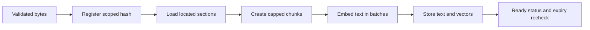

# Ingestion, chunking and embedding

## 1. What this part does

A file must become searchable evidence before a model can answer from it. The pipeline extracts located text, splits it into chunks, embeds those chunks and stores their vectors. It records ready or failed status so requests can avoid unfinished evidence.
### Words used here

| Term | Plain meaning |
| --- | --- |
| Ingestion | Ingestion is the sequence that turns an uploaded or seeded file into stored searchable text. |
| Chunk | A chunk is one bounded piece of document text stored as a retrieval unit. |
| Embedding | An embedding is a numeric representation of text produced by an embedding model. |
| Vector | A vector is an ordered list of numbers; this project requests 768 coordinates per text. |
| Normalization | Vector normalization divides coordinates by vector length so its length becomes one, except a zero vector remains zero. |
| Batch | A batch is a group of inputs submitted in one provider request. |
| Retry | A retry repeats a failed operation within a stated attempt limit. |
| Dataclass | A dataclass is a Python class whose decorator generates common data-container methods from declared fields. |
| Decorator | A decorator applies behavior to a Python declaration, such as generating dataclass methods. |
| Async/await | Async/await allows a waiting task to yield control while other tasks run. |
| Background task | A background task is work performed after the immediate response path rather than a durable external job. |
| OCR | Optical character recognition converts image shapes into text; this application does not implement it. |
| Mermaid | A text format that draws the flow diagrams shown in these documents. |

## 2. Where it lives

app/routers/attachments.py owns the upload endpoint. app/services/document_store.py owns registration and owner-scoped ingestion. app/services/loaders.py converts bytes into Section records; app/services/chunking.py turns those sections into chunk dictionaries. app/services/embeddings.py makes Gemini calls. app/services/ingestion.py stores chunks and final document status. scripts/seed_kb.py uses the same pipeline for the shared library.

Section and LoadResult are dataclasses because loaders need simple internal data holders, not HTTP request validation. Section holds text, location, optional page, kind, heading and an atomic flag. LoadResult collects sections and a bounded set of warnings. Dataclasses also hold ToolSpec and prompt containers elsewhere in the server.

## 3. How it works, step by step

### Upload to searchable chunks

1. The attachment route verifies the login and chat ownership. It accepts one to three multipart files, checks supported extensions and reads at most the user byte limit plus one byte. Empty or oversized content is rejected before embedding.
2. register_document computes SHA-256 over the bytes and combines it with scope, owner and session. A ready/processing duplicate returns the existing record. A failed duplicate can transition back to processing without reserving another chat slot.
3. A new private file reserves one of five chat slots through an atomic conditional session update. Atomic here means that single database update cannot interleave its condition and increment with another update. It is not a transaction covering the entire ingestion pipeline.
4. The handler returns a 202 acceptance response and schedules ingest_scoped with FastAPI BackgroundTasks. An accepted response is not proof of successful extraction, embedding or indexing. The browser polls the attachment list.
5. ingest_scoped checks that both the document and its owner session still exist. It removes old partial chunks for a retry and passes the appropriate private/shared caps to ingest_document.
6. load_file dispatches by extension. It returns located sections or a clear extraction exception. The dispatcher wraps corrupt-file failures and rejects files that contain no extractable text.
7. chunk_sections splits prose and preserves pre-sized atomic sections where safe. Each chunk has display text and embed_text. Only embed_text receives the heading breadcrumb, because search benefits from context but the answer should not be cluttered with repeated headings.
8. embed_documents sends at most 50 texts per call with task type RETRIEVAL_DOCUMENT. It requests the configured dimension and normalizes each returned vector. The default model is gemini-embedding-001, not an answer model.
9. ingest_document inserts rows carrying the scoped metadata, document id, filename, chunk index, location, kind, text and embedding. It then marks the document ready with warnings and chunk count. Heading and embed_text are intermediate values; they are not separately stored in those inserted rows.
10. ingest_scoped rechecks session/document existence after work finishes. If deletion won the race, it removes resulting chunks rather than reviving a deleted chat's files. If activity extended retention, it refreshes expiry using a maximum update.

### Format-specific extraction

| Extension | Actual loader behavior | Limits and omissions |
| --- | --- | --- |
| .txt | Decodes bytes and produces plain located text. | No image reading or semantic interpretation; byte decoding may replace damaged characters. |
| .md | Tracks heading breadcrumbs, code fences and simple pipe tables. | It is a focused parser rather than a complete Markdown specification implementation; embedded tables get row caps. |
| .csv and .tsv | Reads delimited rows, detects a CSV delimiter where possible and builds summaries plus whole-row groups. | Reads at most 200,000 input rows and 200 columns; malformed rows may stop extraction with a warning. |
| .xlsx | Reads visible worksheets with read_only=True and data_only=True, then builds table summaries and row groups. | Hidden sheets are skipped. Cached formula values are used; the loader does not calculate formulas. |
| .docx | Walks paragraphs and tables in body order, preserves heading/list structure and avoids repeated horizontally merged cells. | It does not claim to extract every embedded object or image; table rows can be capped. |
| .pdf | Uses pdfplumber to detect tables and extract text outside them; uses pypdf as a simpler fallback. | The primary path limits pages to 400. The plain pypdf fallback does not apply that same page cap; scanned images need OCR. |
| .pptx | Walks grouped shapes by position, collects text, table values, chart series, notes and useful image alternative text. | Short slides remain atomic. Images are not read with OCR, and chart extraction can report unreadable data. |

### Prose, tables and slides

Prose defaults to 800 characters with 120 characters of overlap. The splitter tries paragraph, line, sentence, word and finally character boundaries. Overlap repeats some neighboring text because a sentence can depend on the previous segment. It does not preserve a whole document's argument automatically.

Tables repeat column names and convert rows to labelled values instead of separating a number from its meaning. Row groups target table_chunk_chars, default 1800. Spreadsheet-style summaries count rows and calculate column statistics over the rows actually read before the searchable-row cap. The summary can describe more rows than the detailed row chunks expose. Numeric uploaded-table statistics use floats, while authoritative bank money uses integer minor units; these are separate code paths.

Short slides up to 3000 characters are marked atomic. Atomic sections over the hard maximum of 7000 characters are still split into smaller pieces. Therefore “atomic” is a preference within an embedding-input safety boundary, not a promise that arbitrarily large tables/slides remain whole.

Ready is recorded after chunk storage, while search visibility can still lag because Atlas updates its vector index separately.

## 4. Key pieces

| Name | Kind | File | What it does | Why it exists |
| --- | --- | --- | --- | --- |
| register_document | function | app/services/document_store.py | Checks scoped dedupe and reserves an upload slot. | Identical private bytes must not expose another user or consume duplicate slots. |
| Section | class | app/services/loaders.py | Carries extracted text and its human-readable location. | Later citations need a file location rather than an unlabelled text block. |
| LoadResult.warn | function | app/services/loaders.py | Adds unique warnings up to the warning cap. | Truncation and unreadable material should be visible rather than silently ignored. |
| load_file | function | app/services/loaders.py | Dispatches the supported extension to the appropriate parser. | Parsing rules belong outside request handlers and model prompts. |
| chunk_sections | function | app/services/chunking.py | Builds display text and heading-enriched embedding input. | Retrieval context and readable answer context have related but different needs. |
| embed_documents | function | app/services/embeddings.py | Embeds chunk text in batches of 50. | Provider requests and free-tier ingestion costs need a bounded batch size. |
| ingest_document | function | app/services/ingestion.py | Coordinates extraction, embedding and database insertion. | One pipeline records consistent ready or failed document states. |
| seed_kb | function | scripts/seed_kb.py | Replaces same-named shared documents before ingestion. | Approved shared evidence is loaded explicitly without adding an admin upload interface. |

## 5. Decisions

| Decision | Because | Alternative not used | Trade-off |
| --- | --- | --- | --- |
| Keep table headers with rows | A fee value without its service name can produce a wrong answer. | Flatten all extracted text into character slices. | Table chunks and summaries require format-specific loader logic. |
| Embed breadcrumbs but display clean text | Headings help relevance without cluttering generated citations. | Embed only an isolated sentence or store only verbose enriched text. | Two intermediate strings must stay associated during chunk processing. |
| Bound private ingestion more tightly | One user file must not exhaust the demo embedding allowance. | Use the larger shared-library caps for every attachment. | Large user documents are only partly searchable and need explicit warnings. |
| Use in-process background ingestion | The project can return acceptance without waiting through all embedding calls. | Require a worker queue and durable job service. | Restarts can interrupt work; cleanup marks old processing records failed. |

## 6. What can go wrong

Gemini _embed_batch makes up to five attempts total for API codes 429, 500 and 503, waiting 2, 4, 8 and 16 seconds between failed attempts. Other API errors are raised immediately. This is not five additional retries. No unbounded retry loop or provider-quota guarantee exists.

When ingestion raises, the handler attempts to delete partial chunks and stores failed status with a shortened exception string. That stored diagnostic can contain extraction details; it is not written into the content-free audit record. If the cleanup database operation itself fails, failure persistence is not guaranteed despite the function's “Never raises” docstring.

Documents processing for over 15 minutes are marked failed by maintenance. This uses created_at rather than a worker heartbeat, so it does not prove a worker is dead. A genuinely slow ingestion can race the sweep. Files are not kept as original raw-byte documents for later download; the shown storage path retains extracted text, vectors and metadata.

Implementation detail: the plain-PDF fallback does not enforce the primary path's page cap. The frontend also waits for ready status before sending, while the API still supports bounded server-side waiting for clients that send processing attachments.

## 7. How to see it working

Read tests/test_phase3.py: test_chunk_and_table_limits_are_passed_without_changing_shared_limits checks private caps and table truncation. test_row_limit_parameter_reaches_table_loaders checks several supported formats. test_concurrent_uploads_cannot_exceed_five_slots checks atomic reservation behavior with a fake collection.

To see status live, upload a small supported file to an owned session, then list attachments until ready or failed. In Mongo, compare its documents record with chunks whose doc_id matches it. Check scope, owner_id, session_id, expires_at, text and vector length. Do not run seed_kb merely to inspect code: it deletes/replaces named shared records and consumes embedding quota. These live operations were not performed for this documentation task.

## 8. Check yourself

1. **Why store embed_text separately during processing?** A heading adds search context, while the clean text remains suitable for evidence and display.

2. **Are all table rows searchable?** No. Read limits, row caps and chunk caps can exclude detailed rows; summaries cover only what was actually read.

3. **What does HTTP 202 prove?** The upload was accepted for processing, not that embedding or vector indexing has finished.

4. **Why normalize embeddings?** The code keeps reduced-dimensional vectors at unit length before similarity storage/search.

5. **Can retrying a failed upload create a new chat slot?** The same scoped file hash can reuse its failed record instead of reserving another slot.

