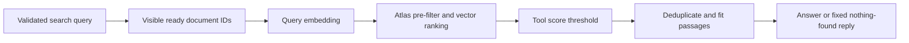

# Retrieval and vector search

## 1. What this part does

Retrieval selects a small set of text chunks that may answer the current question. It searches only approved shared evidence and the caller's files in the current chat. A similarity score ranks permitted evidence; it never grants permission to read a private file.
### Words used here

| Term | Plain meaning |
| --- | --- |
| Retrieval | Retrieval means selecting stored evidence relevant to a query. |
| Query | A query is the search text or database instruction used to find records. |
| Embedding | An embedding is a numeric representation of text used to compare meanings approximately. |
| Vector | A vector is a fixed-length ordered list of numeric coordinates. |
| Cosine similarity | Cosine similarity compares the direction of two vectors rather than their absolute lengths. |
| Index | An index is a stored structure that makes a particular database lookup possible or faster. |
| Pre-filter | A pre-filter restricts eligible records before vector ranking is applied. |
| Scope | Scope labels whether a document is shared or belongs to one user and chat. |
| Projection | A projection selects which database fields are returned. |
| Token | A token is a model-specific text unit; this app estimates tokens from character counts. |
| Async/await | Async/await allows awaited database/network work to release the event loop while it waits. |
| Mermaid | A text format that draws the flow diagrams shown in these documents. |

## 2. Where it lives

app/services/retrieval.py contains visibility_filter, search and ready_document_names. app/tools/document_tools.py validates search arguments and applies min_doc_score to returned hits. app/db.py builds a search-index definition, and atlas/chunks_vector_index.json contains its checked-in default. app/services/prompting.py performs later passage ranking and prompt fitting. app/routers/chat.py decides whether enough evidence remains to call the answer model.

## 3. How it works, step by step

1. plan_turn asks the router model to fill search_documents.query. For a follow-up such as “And the replacement fee?”, the model can produce a standalone query using its short history. This rewrite is model output, not a guaranteed deterministic interpretation.
2. The registry validates SearchArguments, including a nonblank query of at most 4000 characters. It calls documents with a server-built ToolContext. The query argument is model-controlled; owner and session are not.
3. The documents handler calls search with ctx.user_id and ctx.session_id. visibility_filter returns an OR: shared records, or user records with both the matching owner and matching session. Shared knowledge is available to every signed-in user. An attachment in another chat is not included even if the same person owns it.
4. search first asks the documents collection for visible ready records and gathers their string document identifiers. If no ready IDs exist, it returns an empty list before spending a Gemini query-embedding request.
5. When ready IDs exist, embed_query embeds the selected query using task type RETRIEVAL_QUERY. This uses the same configured model and dimension as stored chunks, with a different embedding task instruction.
6. The Atlas pipeline begins with $vectorSearch over the embedding field. Its filter ANDs the visibility rule with membership in the ready-document ID list. A stale indexed chunk whose document was removed should fail that second condition.
7. numCandidates is max(100, top_k multiplied by 20). With the default top_k of five, Atlas considers 100 candidates and returns at most five hits. Candidate breadth trades search work for recall; it is not the number of passages sent to the answer model.
8. The projection returns clean text, location, kind, document id, filename, chunk index and vectorSearchScore. It excludes embedding coordinates and Mongo's internal chunk identifier from the returned evidence dictionary.
9. The documents tool keeps only hits with score at least Settings.min_doc_score, default 0.60. The search function itself does not apply this threshold. Calling search directly and calling the tool are therefore different contracts.
10. The orchestrator merges results from up to two tools and deduplicates document evidence by document id and chunk index. prepare_prompt sorts by score, keeps at most top_k passages and drops complete lower-ranked passages to fit character and token budgets.
11. If no sources remain and no account result exists, the server returns NOTHING_FOUND_MESSAGE without an answer-model call. A bank result can still support a partial mixed answer even when document retrieval is empty or failed.

### The vector index fields

| Field | Index role | Reason |
| --- | --- | --- |
| embedding | vector, 768 dimensions, cosine | The query vector and stored vectors must have the same shape and embedding meaning. |
| doc_id | filter | The ready-document gate excludes unfinished, removed or replaced records from evidence. |
| scope | filter | The query can distinguish approved shared material from private attachments. |
| owner_id | filter | The private branch is limited to the verified user, not a supplied request identity. |
| session_id | filter | Private attachments stay inside the chat they were uploaded to. |

An ordinary Mongo index is not an Atlas Vector Search index. ensure_indexes creates both kinds, but vector pre-filter fields must be declared in the search definition itself. Having a normal owner_id index is not enough to make an undeclared vector filter valid. Existing search-index definitions are not overwritten at startup. The operator must compare and rebuild an old index when filter fields or embedding dimension change.

### A concrete visibility example

Alice's current chat may search the shared fee table and Alice's note uploaded in that chat. Alice's note in a second chat is excluded. Bob's note is excluded. An old chunk with no explicit scope is excluded. A chunk labelled private with Alice as owner but Bob's current session is also excluded because both ownership and chat must match in the private branch.

The request may contain attachment_ids, but those IDs are validated for ownership/readiness rather than becoming a free-form selector for all accessible documents. Follow-up retrieval includes all ready visible files in the chat even when attachment_ids is empty. Therefore the UI is not a document-checkbox interface, and sending one ready attachment ID does not instruct retrieval to ignore the shared library or other ready files.

app/services/retrieval.py — visibility_filter (exact source excerpt):

```python
def visibility_filter(owner_id: str, session_id: str) -> dict:
    return {"$or": [
        {"scope": "shared"},
        {"scope": "user", "owner_id": owner_id, "session_id": session_id},
    ]}
```



Permission filters constrain the search before similarity scoring; later thresholds and budgets decide which permitted evidence reaches generation.

## 4. Key pieces

| Name | Kind | File | What it does | Why it exists |
| --- | --- | --- | --- | --- |
| visibility_filter | function | app/services/retrieval.py | Builds the shared-or-owned-chat rule. | User text cannot change which private evidence is eligible. |
| search | function | app/services/retrieval.py | Collects ready IDs, embeds the query and runs the vector pipeline. | A single scoped function owns the retrieval boundary. |
| ready_document_names | function | app/services/retrieval.py | Lists up to 30 visible ready filenames. | Routing can receive a file-presence signal without sending the document library content. |
| documents | function | app/tools/document_tools.py | Calls scoped search and filters by minimum score. | Raw search hits must pass the same relevance rule for every document question. |
| SearchArguments | class | app/tools/document_tools.py | Validates the model-supplied query. | The tool interface accepts search intent without accepting identity or arbitrary document filters. |
| vector_index_definition | function | app/db.py | Builds the vector field and permitted filter fields. | Runtime index creation should match configured dimension and privacy fields. |
| top_k | setting | app/config.py | Defaults the returned/fitted passage count to five. | A small evidence set limits prompt cost and citation complexity. |
| min_doc_score | setting | app/config.py | Rejects tool hits below the default 0.60 score. | Weak semantic matches should not become evidence just because they are the nearest available text. |

## 5. Decisions

| Decision | Because | Alternative not used | Trade-off |
| --- | --- | --- | --- |
| Use one OR-filtered vector query | The code expresses shared and owned evidence in one pre-filtered search. | Run two independent searches and merge them. | It depends on the deployed Atlas version supporting this filter shape. |
| Gate by ready document IDs | Search indexes can lag document deletion or replacement. | Trust every indexed chunk regardless of its parent record. | Every search performs a separate documents lookup and sends an ID list. |
| Apply a relevance threshold | The nearest result can still be unrelated. | Always answer from the top available hit. | A strict threshold can reject useful evidence; quality needs live evaluation. |
| Keep whole passages when fitting | Cutting through a number or condition can change meaning. | Trim every passage to an arbitrary text prefix. | Fewer complete passages may fit into the final prompt. |

## 6. What can go wrong

Atlas can reject a filter when the deployed index lacks a declared field. There is no unfiltered retry that drops the privacy rule. The tool registry turns the exception into a data_unavailable result. If nothing else succeeds, the fixed unavailable reply is used; a successful account result can still support a limited mixed answer.

A ready document may not be searchable immediately because indexing is eventually consistent, meaning storage and search visibility can update at different times. A no-result answer can therefore mean missing evidence, poor query wording, a score below threshold, prompt pruning or indexing delay. It is not proof that the underlying policy does not exist.

The vector score is a ranking signal, not a calibrated probability that a sentence is true. Cosine behavior and returned Atlas scores depend on the service; current live behavior was not tested here. The repository's tests supply vectors/scores and inspect pipeline filters rather than performing a real semantic nearest-neighbor search.

Differs from DESIGN.md: fixed replies avoid the answer model, but document retrieval and routing may already have consumed provider calls. Also, the code passes only bool(doc_names) as has_files to the router; that list includes shared ready documents, so the flag does not specifically mean a current message has attachments.

## 7. How to see it working

Inspect atlas/chunks_vector_index.json alongside app/db.py, then inspect the filter in search. tests/test_phase3.py contains test_retrieval_filter_and_followups_never_include_other_files, which asserts shared-plus-current-chat filtering and excludes legacy unscoped records. tests/test_phase4a.py contains test_document_context_and_success_audit, which checks that handler identity comes from context and the threshold removes weak hits.

For live observation, use an owned chat and a question about the seeded fee schedule. Inspect returned filenames, locations and scores, then ask from another user's chat. To investigate a newly ready upload, check the deployed index state and allow indexing time before interpreting a missed result. These live Atlas checks are not confirmed by reading the local JSON definition and were not run while writing these documents.

## 8. Check yourself

1. **Why must filter fields be in the vector index?** Atlas must support those fields in the vector pre-filter; ordinary collection indexes do not substitute for that definition.

2. **Does top_k mean candidate count?** No. Candidate count is max(100, top_k times 20); top_k limits returned hits.

3. **Where is the 0.60 threshold applied?** In the documents tool handler after search returns its hits.

4. **Can Alice search her attachment from another chat?** No. The private filter requires both her user id and the current session id.

5. **Does an empty result prove the bank has no such policy?** No. It proves this retrieval path supplied no qualifying fitted evidence for the turn.
