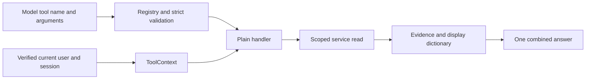

# Routing and tools

## 1. What this part does

The router chooses which read-only data functions a message needs. It does not execute database queries itself and cannot choose a user or customer identity. Plain handlers adapt its validated arguments to server-owned context and service calls.
### Words used here

| Term | Plain meaning |
| --- | --- |
| Native tool calling | Native tool calling is a model API response format that names a function and supplies structured arguments for the application to validate and run. |
| Schema | A schema describes the permitted fields, types and constraints of structured data. |
| Pydantic | Pydantic validates Python data against declared fields and constraints. |
| Registry | A registry is a mapping from permitted names to their implementation descriptions and handlers. |
| Handler | A handler is the function the application calls to perform an approved operation. |
| Context | Context here means the verified user/customer/session data supplied by the server to tools. |
| Dataclass | A dataclass is a Python data container whose decorator generates common methods from fields. |
| Decorator | A decorator applies behavior to a declaration, such as dataclass generation or a field validator. |
| Validation | Validation checks that supplied values match required types, permitted fields and bounds. |
| Async/await | Async/await lets network/database waits share an event loop without treating all work as parallel CPU execution. |
| Parallel tool execution | Parallel tool execution starts independent awaited tool work together and waits for their combined results. |
| Minor units | Minor units are integer fractions of a currency unit; INR in this service uses 100 minor units per rupee. |
| Mermaid | A text format that draws the flow diagrams shown in these documents. |

## 2. Where it lives

app/services/router.py owns PLANNER_PROMPT, ReplyArguments, ToolCall, Plan and plan_turn. app/tools/registry.py owns ToolContext, Arguments, ToolSpec, registry, schemas and execute. app/tools/account_tools.py and app/tools/document_tools.py register the four data tools at import time. app/bank/service.py reads bank records through app/bank/db.py. scripts/seed_bank.py constructs the fictional bank dataset independently of the model.

## 3. How it works, step by step

1. Importing the router imports account_tools and document_tools. Their module assignments add ToolSpec objects to registry. There is no plugin discovery or dynamically imported model-selected Python module.
2. Each ToolSpec holds a fixed name, description, argument-model class, handler and read_only flag. The frozen dataclass prevents reassignment of its fields. Its schema method exposes only argument fields, not ToolContext.
3. plan_turn shortens its history input and builds five model-visible tools: the four registry data tools plus reply_without_data. The latter is a planner-only control, not a normal data handler in registry.
4. The model request uses tool_choice required, temperature zero and max_completion_tokens 250. GPT-OSS uses parallel_tool_calls false and a single select_tools selection containing up to two calls; other configured models retain direct native parallel selection. These are API request parameters; they are not a guarantee of a correct route from a live model.
5. The server parses each returned function argument string as JSON. Unknown tools, invalid JSON, extra fields and invalid types/values are skipped. Arguments uses strict types and forbids extras, so a customer_id field is rejected rather than ignored.
6. At most two valid data calls are retained, in model-return order. Invalid calls do not consume those two positions. There is no deduplication by tool name at this step. A model can select two searches; later document deduplication handles overlapping evidence.
7. A valid data selection wins over reply_without_data if both appear. If no valid data calls remain but a valid fixed-reply kind exists, it is used. With no usable plan, the router repeats the planning attempt once. Persistent generic failure falls back to document search using the original message.
8. AssistantBusy is deliberately re-raised instead of becoming document search. A provider throttle is not evidence that a different tool will answer the question. The outer Groq retry wrapper has its own bounded short-rate retry, so logical planning attempts and network attempts are not identical counts.
9. run_chat constructs ToolContext from the verified CurrentUser and owned request session. The model never returns these fields. execute validates arguments again, invokes spec.handler(ctx, args) and records a tool_call audit in finally.
10. asyncio.gather starts the selected handlers together. Each handler returns a dictionary containing model evidence plus a display block when appropriate. The orchestrator combines successful results and supplies them to one logical answer generation call.

### Every exposed operation

| Model-visible name | Arguments | Plain handler and service | Result contract |
| --- | --- | --- | --- |
| search_documents | query: nonblank string, maximum 4000 characters | documents in app/tools/document_tools.py; search in app/services/retrieval.py | documents list after min_doc_score; no account display block. |
| get_balances | Empty strict argument object | balances; app/bank/service.py get_balances | accounts list with type, nickname, masked number, currency, integer balance_minor and formatted balance; balances display block. |
| get_recent_transactions | Optional account_type: savings/current/credit_card; optional integer limit, default 5, range 1–20 | recent_transactions; app/bank/service.py get_recent_transactions | Newest transactions across matching owned accounts, limited in total; transactions display block. |
| get_card_status | Empty strict argument object | card_status; app/bank/service.py get_card_status | kind, last4, status and expiry fields for owned cards; cards display block. |
| reply_without_data | kind: greeting, thanks or out_of_scope | Handled by plan_turn and fixed replies in run_chat | No registry data read; the orchestrator writes a zero-latency tool_call audit for this choice. |

The transaction limit is across the customer's matching accounts, not five per account. The service first loads owned accounts and builds their permitted account IDs. It then queries transactions by those IDs because transaction rows have no customer_id field. An account_type is a category, not an identifier that could select someone else's account.

### Bank data and formatting

build_seed creates three customers, six accounts distributed one/two/three across Alice/Bob/Carol, 36 transactions per account and one debit card per account. There are 216 transactions and six cards. Fixed customer IDs match seed_users: demo-customer-001 through demo-customer-003. Account values come from deterministic positive transaction amounts and credit/debit directions. The seed accumulates a signed running balance, storing each balance_after_minor and the final account balance_minor.

format_money supports INR only. It divides an absolute integer by 100 with divmod and adds commas, a sign and two fractional digits. It never converts bank money to floating point. Models and the frontend use the resulting balance/amount strings rather than recalculating money. Account numbers are reduced to four trailing digits; card records expose only last4, not a complete card number.

All seeded cards are active debit cards expiring in December 2029. All seeded accounts are savings or current. The service can validate/read additional declared account/card categories, but the seed does not exercise every allowed enum value. Do not claim credit-card demo rows exist merely because the type permits them.

### What is deterministic and what is not

The tool-name allowlist, schema validation, cap of two retained calls, server identity injection, bank ownership queries, score threshold and fallback are deterministic server rules. There is no separate keyword classifier that forcibly corrects “balance” questions to get_balances. There is no deterministic semantic backstop that guarantees the model selects the right pair of tools. PLANNER_PROMPT tells it how to choose; tests check what happens to supplied choices.

The read_only flag documents a contract. execute does not inspect a query or enforce database permissions based on that flag. Current handlers contain only reads, and an operator can further restrict the bank connection to read-only credentials. Actual database roles are not confirmed from code.

app/tools/registry.py — ToolContext (exact source excerpt):

```python
class ToolContext(BaseModel):
    model_config = ConfigDict(frozen=True, extra="forbid", strict=True)
    user_id: str
    customer_id: str
    session_id: str
```



The model supplies intent while the server supplies authority; they meet only after argument validation.

## 4. Key pieces

| Name | Kind | File | What it does | Why it exists |
| --- | --- | --- | --- | --- |
| ToolContext | class | app/tools/registry.py | Holds immutable strict user, customer and session identity. | Model arguments must never become an authority to choose another person. |
| Arguments | class | app/tools/registry.py | Forbids extra fields and implicit type coercion. | Unknown identity fields must be errors rather than silently accepted data. |
| ToolSpec.schema | function | app/tools/registry.py | Serializes the argument model into the native tool schema. | Only model-controlled inputs should be visible in the tool contract. |
| execute | function | app/tools/registry.py | Revalidates, invokes and audits one registry handler. | Validation and content-free audit cannot depend on every caller remembering them. |
| Plan.tool_calls | function | app/services/router.py | Returns explicit calls or derives the compatible single action. | The orchestrator consumes one consistent call-list interface. |
| TransactionArguments | class | app/tools/account_tools.py | Defines account category and bounded transaction count. | The model can refine a read without selecting an identity or unlimited output. |
| get_recent_transactions | function | app/bank/service.py | Resolves owned accounts before reading latest rows. | Transaction data needs an ownership join in application code. |
| build_seed | function | scripts/seed_bank.py | Constructs deterministic coherent fictional records. | Repeatable demo values and transaction sums make isolation tests inspectable. |

## 5. Decisions

| Decision | Because | Alternative not used | Trade-off |
| --- | --- | --- | --- |
| Keep plain ctx/args handlers | The project plans to replace orchestration later without rewriting bank reads. | Import an agent framework or LLM client inside every handler. | The current router must assemble and validate tool plans explicitly. |
| Keep identity outside schemas | An untrusted model can invent argument values. | Ask the model to return the current customer ID correctly. | Handlers need an additional server-supplied context object. |
| Read balances from bank records | The authoritative data store owns financial values. | Let the answer model sum retrieved transactions. | A separate seed consistency test must verify the stored balance relationship. |
| Cap selected tools at two | Mixed questions need a small bounded amount of work under free-tier constraints. | Allow arbitrary tool sequences and iterative autonomous planning. | A question needing three distinct tools may only receive a partial response. |

## 6. What can go wrong

The registry returns a small data_unavailable marker on handler/validation exceptions, rather than returning raw exception text. The orchestrator decides whether remaining evidence supports an answer. Empty account lists are successful authoritative results, not failures.

An audit database failure is a separate limitation: audit_event is awaited in finally without its own suppression, so execute can still raise if writing that event fails. The read-only flag does not make that audit write a bank-data write; the audit belongs to the app database.

The router can misclassify a legitimate banking question as a fixed refusal or choose two redundant tools. Those semantic errors are not solved by strict typing. Query rewriting and model obedience were not tested live for this documentation task. The correct claim is that invalid authority fields are rejected and owned reads are enforced when approved handlers execute.

## 7. How to see it working

Read test_schemas_no_identity in tests/test_phase4a.py; it checks registry schemas. Read test_transaction_arguments_reject_invalid and test_plain_service_and_handler_boundaries in tests/test_phase4b.py. The latter checks handler parameter names and forbids router/LLM/framework imports in bank and handler modules.

Use test_mixed_tools_parallel_one_answer to see two handlers deliberately wait for one another's start events, proving concurrent scheduling under the fixture. test_seed_consistency in tests/test_phase4a.py checks each account balance against its signed transaction sum. Live bank checks require seeded databases and were not executed here.

## 8. Check yourself

1. **Why are customer IDs absent from model schemas?** The model is untrusted; the verified user record supplies authority through ToolContext.

2. **Can get_recent_transactions return five rows from each account?** No. Its limit applies to the newest matching rows in total.

3. **Does read_only enforce Mongo permissions?** No. Current service code performs reads; actual database credentials must enforce additional permission restrictions.

4. **What happens after two unusable planner attempts?** The router returns a document-search plan using the original message, except provider busy errors propagate.

5. **Could CrewAI replace the bank service without changes today?** The plain service/handler boundaries support later orchestration replacement, but no CrewAI implementation exists now.


Model compatibility update: GPT-OSS routing uses one native `select_tools` call with up to two independently validated selections, because parallel native calls are unsupported. Server-side handlers still run in parallel. GPT-OSS calls use low reasoning effort, exclude returned reasoning, and use `max_completion_tokens`; completion caps remain unchanged. See the model compatibility section in the README.
