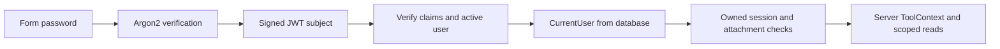

# Authentication, sessions and security

## 1. What this part does

Authentication establishes who is making a request; ownership checks decide which chat or data that person may access. The server reloads identity from the user record and carries it into scoped reads. Audit and retention record operational events and remove old private chat material without storing message contents in the audit log.
### Words used here

| Term | Plain meaning |
| --- | --- |
| Authentication | Authentication verifies a claimed login identity. |
| Authorization | Authorization checks whether the verified identity may perform a specific operation on specific data. |
| Hash | A password hash is a one-way verification value rather than an encrypted password that the server can decrypt. |
| Argon2 | Argon2 is the password-hashing algorithm used through pwdlib in this project. |
| JWT | A JSON Web Token is a signed set of claims used here as a short-lived bearer credential. |
| Claim | A claim is a named value inside a token, such as its subject or expiry. |
| HS256 | HS256 signs and verifies token data using HMAC-SHA256 with one shared server secret. |
| Bearer token | A bearer token authorizes whoever presents it, so its secrecy matters. |
| Dependency injection | Dependency injection lets FastAPI supply a verified CurrentUser before a route function runs. |
| Decorator | A decorator adds behavior or registration to a Python declaration. |
| Async context manager | An async context manager runs entry/exit logic around an async with block and can await during that work. |
| Retention | Retention is the rule for how long inactive private data is kept. |
| CORS | Cross-Origin Resource Sharing controls whether a browser origin may read another origin response. |
| XSS | Cross-site scripting is malicious script execution in a trusted page, which can expose browser-readable tokens. |
| Mermaid | A text format that draws the flow diagrams shown in these documents. |

## 2. Where it lives

app/auth/security.py owns password hashing, JWT creation/verification and get_current_user. app/auth/router.py exposes form login and a current-user summary. app/auth/throttle.py owns login attempt state. app/services/memory.py enforces chat ownership and persistence. app/services/attachments.py resolves private file IDs. app/services/audit.py writes event records, while app/services/maintenance.py purges inactive sessions and stale documents. app/main.py installs CORS and schedules retention.

## 3. How it works, step by step

### Login and token verification

1. seed_users inserts three fictional accounts with fixed user/customer links. Each password is hashed through hash_password. The seed uses $setOnInsert so running it again does not reset an existing password or unlock an account.
2. POST login accepts OAuth2PasswordRequestForm, which is URL-encoded form data rather than a JSON password body. OAuth2 here provides the Swagger/browser contract; the app does not implement an external identity provider or public registration service.
3. The username is lowercased. LoginThrottle.attempt holds one asyncio lock around its prune/check/yield sequence and the caller's verification body. This serializes checks, including password verification, so simultaneous failed attempts cannot bypass the cap.
4. The route fetches the user by normalized username. An unknown username still verifies the supplied password against a precomputed dummy hash, reducing the obvious timing difference between unknown and wrong-password accounts.
5. verify_password uses run_in_threadpool because password hashing is expensive synchronous work. It catches verification exceptions and treats them as failure. A locked account, unknown account and wrong password receive the same 401 detail.
6. Five failed attempts for a username within 900 seconds set a block for another 900 seconds. A later attempt during that block returns 429 with Retry-After 900. A successful login clears that username's failures. In-memory state resets on process restart and is not shared across workers.
7. create_access_token emits sub, iat and exp. The subject is the user ID. Default lifetime is 30 minutes. HS256 is fixed in creation and allowed verification algorithms. The token is signed, not encrypted; do not put balances, passwords or provider keys in it.
8. OAuth2PasswordBearer extracts the bearer token for protected endpoints. get_current_user verifies signature, required claims, expiry and the subject's shape, then reloads the user by _id and rejects missing/inactive users.
9. CurrentUser is constructed from the database record's user_id, username and customer_id. Extra identity claims in a correctly signed token do not override that record. ToolContext is later built from this verified object and the owned session.

### Ownership and sessions

require_session queries by both session _id and user_id. Missing and foreign sessions both return 404 with Session not found, so the route does not confirm another person's identifier. History reads additionally filter messages by user_id, protecting against even a mislabelled row that shares a session ID.

create_session makes a UUID string ID and empty title. save_message sets the first user-message prefix as the title, limited to 80 characters. list_sessions returns the latest 30 by activity by default; it has no pagination API. get_recent returns bounded model context, while get_full_history returns stored conversation rows in time order.

clear_session removes the session first, then owned messages, private document records and chunks. Later requests fail ownership checks. This sequence is not a multi-collection transaction; a database failure can interrupt cleanup. Slow ingestion rechecks existence before/after embedding to reduce orphan recreation after deletion.

Attachment lookup converts provided document strings into ObjectIds, deduplicates them and queries by private scope, owner and current session. A malformed, missing or foreign ID returns the same Attachment not found response. A document ID is a reference to validate, not proof of ownership.

### Audit and cleanup

Audit events include login_ok, login_fail, chat, tool_call, refusal, upload, session_deleted, rate_limited and retention_purge. Rows include UTC timestamp, event, optional user/session/tool, outcome, empty detail and optional duration or count summary. They exclude message text, passwords, balances and raw tool arguments. An append-only convention exists through the API because no route edits these events; database administrators are not restricted by that application convention.

purge_expired runs at startup and then hourly. It scans sessions older than retention_days, default 30, then rechecks the inactivity condition in the delete operation so a recently touched chat can survive the scan. It removes that owner's messages, documents and chunks. It separately removes expired private documents, their chunks and a reserved attachment slot. Shared library records are not removed by the private expiry rule.

The sweep also marks processing documents older than 15 minutes failed. Later hourly purge failures log only exception type and the loop continues. Initial startup purge failure is not swallowed by lifespan. Retention is application-driven cleanup, not a Mongo TTL index or an exact expiry alarm.

app/auth/security.py — create_access_token (exact source excerpt):

```python
def create_access_token(user_id: str) -> str:
    settings = get_settings()
    now = datetime.now(timezone.utc)
    return jwt.encode({"sub": user_id, "iat": now,
                       "exp": now + timedelta(minutes=settings.access_token_minutes)},
                      settings.jwt_secret.get_secret_value(), algorithm="HS256")
```



A token identifies the user record; that record supplies the customer link used for authorized reads.

## 4. Key pieces

| Name | Kind | File | What it does | Why it exists |
| --- | --- | --- | --- | --- |
| CurrentUser | class | app/auth/security.py | Carries verified identity inside the server. | The model and browser must not choose the bank customer link. |
| get_current_user | function | app/auth/security.py | Checks token claims and reloads active user data. | An inactive or removed user must fail even with an unexpired token. |
| LoginThrottle.attempt | function | app/auth/throttle.py | Serializes login checks under an async lock. | Parallel attempts must not all observe the same unused failure allowance. |
| require_session | function | app/services/memory.py | Requires both session and owner match. | A guessed session string must not reveal another conversation. |
| resolve_attachments | function | app/services/attachments.py | Validates current-chat private document IDs. | An authenticated user still cannot attach another user’s or another chat’s evidence. |
| audit_event | function | app/services/audit.py | Appends content-free operational records. | The demo needs traceable outcomes without duplicating sensitive content into logs. |
| purge_expired | function | app/services/maintenance.py | Deletes inactive/expired private data and sweeps stale processing. | Files must share the conversation retention lifecycle rather than remain indefinitely. |
| cors_origins | setting | app/config.py | Names explicit browser origins allowed by middleware. | Local development can be allowed without opening every website origin. |

## 5. Decisions

| Decision | Because | Alternative not used | Trade-off |
| --- | --- | --- | --- |
| Hash rather than encrypt passwords | Login needs verification, not password recovery. | Store plaintext or reversible password ciphertext. | Users need an out-of-band reset mechanism; this demo has no reset UI. |
| Sign short-lived access tokens | Each request can verify a bearer token and reload an active user. | Store a separate opaque session token row for every login. | There is no individual token revocation list or refresh-token workflow. |
| Return 404 for foreign resources | Foreign and missing identifiers should not reveal existence. | Return 403 only for an existing foreign row. | The client sees a generic unavailable-resource result. |
| Use local memory for throttles | A single-worker small demo can avoid adding Redis. | Use a distributed limiter from the beginning. | Multiple workers/restarts do not share the protection state. |

## 6. What can go wrong

### Threats and actual defenses

| Threat | Defense in code | Remaining limit |
| --- | --- | --- |
| Forged or modified JWT | HS256 verification, required claims and active-user lookup. | A stolen valid bearer token remains usable until expiry or user locking/removal. |
| Password guessing | Argon2, generic denial, dummy hash, username throttle and event audit. | The throttle is process-local and one global lock serializes all username checks. |
| Foreign chat ID | Every session lookup includes verified user_id and returns 404 on mismatch. | Multi-step deletion/persistence is not transactional. |
| Foreign attached document | ObjectId lookup requires user scope, owner_id and session_id. | Ownership must remain correct in stored metadata and indexes. |
| Injected customer tool argument | Strict schemas forbid identity; handlers take server context. | Prompt injection may still affect wording or tool choice within the allowed authority. |
| Cross-user dedupe clue | Hash uniqueness is private-owner/session scoped. | Shared documents intentionally have a different visibility boundary. |
| Browser token theft | Raw HTML is skipped, remote images suppressed and logout/401 clears token storage. | sessionStorage is still readable by script; XSS is not eliminated by storage choice. |
| Leaked operational logs | Audit rows exclude content; chat diagnostics avoid exception text. | Stored ingestion errors and evaluation reports are different data stores, not content-free audit logs. |
| Cross-origin browser page | Explicit CORS list rejects wildcard configuration. | CORS is not authentication and does not restrict nonbrowser HTTP clients. |

Differs from DESIGN.md: saved message rows have content, sources and attachment references but no account_data/card field.

JWTs cannot be revoked individually, but the current-user lookup does reject a user that has been locked or removed since token issuance. Public documentation, health, login, the root redirect and static login assets are exceptions to blanket authentication wording. Production hardening, TLS termination, backup policy and actual database credential roles are not confirmed from the code.

## 7. How to see it working

Read tests/test_phase2.py: test_unknown_wrong_password_and_locked_have_same_error, test_bad_tokens_rejected, test_session_ownership_chat_and_delete, test_identity_loaded_from_user_record_not_extra_token_claims and test_audit_is_content_free. These tests demonstrate separate authentication, authorization and logging contracts.

Read test_retention_cascade_expired_files_and_stuck_docs and test_retention_does_not_delete_session_touched_after_scan in tests/test_phase5.py for cleanup behavior. A live demonstration should log in as Alice and Bob in separate browser contexts, verify different chat lists and probe a foreign session for 404. Never display the bearer token or real secret during that demonstration. No live authentication or database calls were executed for this documentation task.

## 8. Check yourself

1. **Is JWT encryption?** No. Its signature detects changes; its claims can be read by a token holder.

2. **Can a signed customer_id claim override the database record?** No. CurrentUser reloads the customer link from the active user record.

3. **Why 404 instead of 403 for Bob reading Alice’s session?** It avoids confirming that a foreign identifier exists.

4. **Does logout revoke the token on the server?** No. It clears browser-held token state; no per-token revocation list exists.

5. **Does retention delete shared knowledge documents?** Not through the private expiry rule; stale processing shared documents can still be marked failed.
