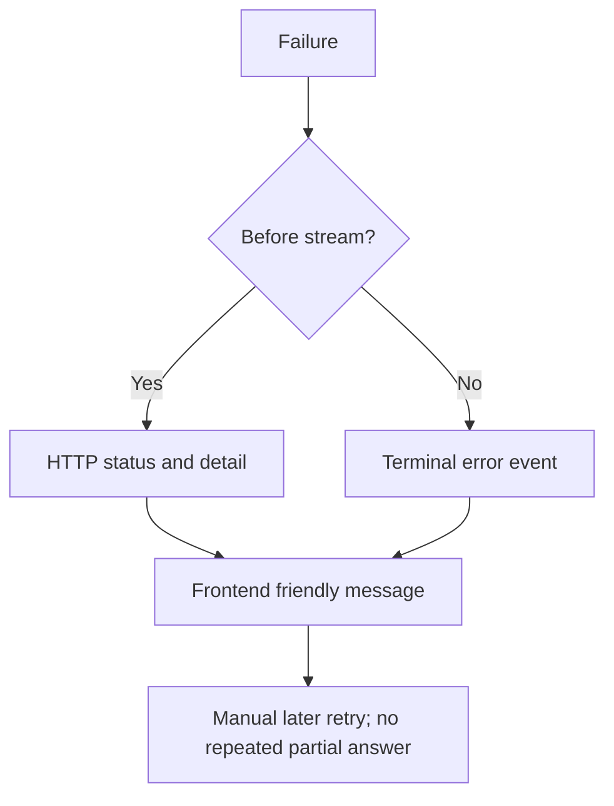

# Errors, limits and reliability

## 1. What this part does

The reliability code bounds waiting, requests, prompt size and ingestion work. It separates failures before streaming from failures inside a started stream and preserves successful data when another tool fails. It cannot guarantee provider availability, database atomicity or a truthful model answer.
### Words used here

| Term | Plain meaning |
| --- | --- |
| Rate limit | A rate limit restricts request starts over a time interval. |
| Retry-After | Retry-After is an HTTP header suggesting how long a client should wait before another attempt. |
| Semaphore | A semaphore limits how many tasks can hold a concurrency slot simultaneously. |
| Retry budget | A retry budget is the finite number of repeat attempts allowed for one operation. |
| Backoff | Backoff increases the wait between repeated failed requests. |
| HTTP status | An HTTP status is the response code describing request success or failure before a body is interpreted. |
| SSE | Server-sent events carry named text events after a streaming HTTP response has begun. |
| Idempotent | An idempotent operation has the same intended persistent effect when safely repeated as when performed once. |
| Token | A token is a model-specific unit of text; local budget estimates use characters divided by four. |
| Async/await | Async/await lets waiting work yield control, but synchronous parsing can still occupy the event loop. |
| Mermaid | A text format that draws the flow diagrams shown in these documents. |

## 2. Where it lives

app/services/groq_runtime.py owns Groq retry and concurrency rules. app/services/embeddings.py owns Gemini retry and batching rules. app/services/rate_limits.py owns the per-user chat window. app/routers/chat.py translates turn failures into events, while auth and upload routes return ordinary HTTP errors. app/services/maintenance.py recovers old processing records. frontend/src/api.ts and frontend/src/App.tsx translate both HTTP and event failures into visible messages.

## 3. How it works, step by step

### Failure handling order

1. Invalid request bodies or missing/invalid bearer credentials fail before chat generation. Owner checks and supplied attachment resolution run before the chat rate reservation. Those failures do not open an SSE stream.
2. The local chat limiter rejects excess starts before router/answer work. It returns a friendly HTTP 429 and Retry-After. It is keyed by user rather than chat, so making another chat does not bypass that user's allowance.
3. Accepted requests can queue for a Groq semaphore slot. The default two slots cover both planning requests and the full lifetime of answer streams. Extra work waits for a slot; no separate semaphore queue timeout is implemented.
4. call_groq catches RateLimitError and parses Retry-After as a number or HTTP date. Missing, malformed or nonfinite values default to 60 seconds. A first delay of ten seconds or less is waited once and retried; a second failure or a longer delay becomes AssistantBusy.
5. stream_groq follows the same short-retry rule only before content has been emitted. A role-only or empty provider chunk does not count as visible content. After content is emitted, a retry could duplicate text and is not attempted. The response is closed in finally and the concurrency slot is released on completion or cancellation.
6. Router structural/generic failures allow two logical planning attempts, then document fallback. This is separate from each wrapper's provider rate retry. Busy is re-raised, not hidden by search fallback. Therefore normal-call counts and maximum HTTP attempts need to be described separately.
7. Gemini embedding calls make up to five attempts total for codes 429, 500 or 503. Delays are 2, 4, 8 and 16 seconds. Other errors escape immediately. The loop is per batch, so a large file can have several batches with independent attempt budgets.
8. A data handler failure becomes the registry's unavailable marker. The orchestrator uses any successful account/doc evidence with an explicit unavailable note. With no remaining usable result, it sends the fixed unavailable text and skips the answer call. Empty account data is a successful result, not a failure.
9. Ingestion failure attempts partial chunk cleanup and records failed status. Startup/hourly maintenance marks documents processing for over 15 minutes failed. These are recovery actions, not a durable retry queue that resumes the interrupted upload automatically.
10. The browser never automatically re-sends an incomplete answer request. It retains visible partial text as incomplete, restores the draft, displays a friendly error and allows a deliberate later retry. Login expiry clears the token and switches to the login screen.

### Failure paths and exact client-facing messages

N below is the computed integer delay; filename/limit values are inserted by the implementing function. Structured 422 validation bodies can contain field-specific details; the UI deliberately replaces them with a short general message rather than displaying the raw body.

| Path | Signal and exact text | Implementation |
| --- | --- | --- |
| Wrong/unknown/locked login | HTTP 401: Incorrect username or password | app/auth/router.py — LOGIN_ERROR |
| Throttled login | HTTP 429: Incorrect username or password; Retry-After: 900 | app/auth/router.py — login; browser shows Too many sign-in attempts. Please try again in N seconds. |
| Invalid verified credentials | HTTP 401: Could not validate credentials | app/auth/security.py — unauthorized; missing bearer extraction can instead say Not authenticated. |
| Foreign/missing chat | HTTP 404: Session not found | app/services/memory.py — require_session |
| Bad/foreign attachment ID | HTTP 404: Attachment not found | app/services/attachments.py — resolve_attachments |
| Excess chat traffic | HTTP 429: You're sending messages too quickly. Please try again in about N seconds. | app/services/rate_limits.py — rate_message |
| Long/exhausted provider throttle | error: The assistant is busy. Please try again in about N seconds. | app/services/groq_runtime.py — AssistantBusy |
| Oversized required context | error: The request is too large to answer. Please ask a shorter question. | app/routers/chat.py — run_chat |
| Generic turn failure | error: The assistant could not complete your request. Please try again. | app/routers/chat.py — CHAT_ERROR_MESSAGE |
| Failed requested attachment | error: An attached file failed to process. Please upload it again. | app/services/attachments.py — attachment_events |
| Attachment wait timeout | error: Attached files are still processing. Please try again when they are ready. | app/services/attachments.py — attachment_events |
| Upload request count | HTTP 400: Upload between 1 and 3 files at a time. | app/routers/attachments.py — upload_attachments |
| Unsupported file | Per-file rejected: Unsupported file type. | app/routers/attachments.py — upload_attachments |
| Empty/oversized file | Per-file rejected: File is empty or exceeds the upload size limit. | app/routers/attachments.py — upload_attachments |
| Chat attachment cap | Per-file rejected: At most 5 files are allowed per chat. | app/services/document_store.py — register_document |
| Stuck ingestion | Stored error: Processing was interrupted. Please upload the file again. | app/services/maintenance.py — sweep_stuck_documents; not returned as raw attachment-list error. |
| No qualifying document evidence | I couldn't find that in our documents. Please contact customer support for help. | app/services/llm.py — NOTHING_FOUND_MESSAGE |
| No successful data after failure | I can't fetch your account details right now. Please try again in a moment. | app/services/llm.py — DATA_UNAVAILABLE_MESSAGE |
| Invalid generated amount | Please see your verified account details in the account card. | app/services/llm.py — ACCOUNT_AMOUNT_MESSAGE |
| Browser network failure | We could not connect. Please check your connection and try again. | frontend/src/api.ts — request |
| Browser HTTP 429 | Too many requests. Please try again in N seconds. | frontend/src/api.ts — request; shows countdown and disables send. |
| Browser generic HTTP failure | We could not complete that request. Please try again. | frontend/src/api.ts — friendly/request |
| Browser 404 | This chat or file is no longer available. Please open another chat. | frontend/src/api.ts — request |
| Browser 422 | The request could not be accepted. Check the message length and try again. | frontend/src/api.ts — request |
| Unexpected nonstream chat response | The server did not return a streaming reply. Please try again. | frontend/src/api.ts — sendChat |
| Malformed stream payload | The reply could not be read. Please try again. | frontend/src/api.ts — readEvents |
| Stream ended without terminal event | The reply was interrupted. Please try again. | frontend/src/api.ts — readEvents |
| User stops generation | Reply stopped. You can ask again when you are ready. | frontend/src/App.tsx — Workspace local send |

Other extraction diagnostics are produced by load_file for corrupt, encrypted or textless files, and warnings describe truncation/skipped material. Their variable text is stored with the document; the attachment list exposes warnings but not its raw error field. A failed file in the UI therefore has a clear generic processing message rather than a copied provider exception. Fixed greeting/thanks/out-of-scope texts are listed in document 07.

Clients must interpret both HTTP errors and terminal stream events, because a started stream cannot change its status code.

## 4. Key pieces

| Name | Kind | File | What it does | Why it exists |
| --- | --- | --- | --- | --- |
| AssistantBusy | class | app/services/groq_runtime.py | Carries a rounded retry delay and a safe busy message. | Provider details should not be exposed as raw exception text. |
| retry_seconds | function | app/services/groq_runtime.py | Parses numeric/date retry headers with a safe fallback. | Malformed provider timing must not cause unbounded waiting or crashes. |
| groq_slot | function | app/services/groq_runtime.py | Shares a semaphore per event loop and configured limit. | Router calls and answer streams compete for the same bounded capacity. |
| check_rate_limit | function | app/services/rate_limits.py | Atomically reserves a local per-user rolling-window slot. | Rapid requests need a predictable rejection before provider work. |
| MAX_RETRIES | constant | app/services/embeddings.py | Sets the embedding attempt count to five. | Transient failures get finite recovery rather than an unbounded loop. |
| sweep_stuck_documents | function | app/services/maintenance.py | Marks old processing records failed. | A process restart must not leave every client waiting forever on lost work. |

## 5. Decisions

| Decision | Because | Alternative not used | Trade-off |
| --- | --- | --- | --- |
| Disable Groq SDK automatic retries | Application rules need to control total retry and waiting behavior. | Let the SDK add hidden retries under the application loop. | The application must handle supported retry cases explicitly. |
| Retry only before visible text | A partial answer cannot be safely replayed as if nothing arrived. | Restart a stream after every rate error. | The user sometimes sees an incomplete answer and must retry deliberately. |
| Preserve partial tool success | Useful evidence can remain when one independent source is unavailable. | Fail the entire turn whenever one tool fails. | The answer must clearly state the missing part. |
| Keep limits local and explicit | The demo needs inspectable bounds without a distributed control service. | Claim provider free-tier quotas are enforced globally by these settings. | Multiple workers, other apps and account quotas are outside these local limits. |

## 6. What can go wrong

### Free-tier settings and what they protect

These are application defaults, not provider quota claims. Model-specific request/token-per-minute allowances and actual Atlas storage limits must be read from the owner's consoles; they were not inspected here.

| Setting in app/config.py | Default | Protected resource or boundary |
| --- | --- | --- |
| router_history_messages | 4 | Restricts how many already-budgeted history messages the planner sees, reducing planner request size. |
| router_message_chars | 300 | Truncates each planner history message; it does not truncate the current request message. |
| top_k | 5 | Caps returned/fitted passages; candidate breadth separately uses max(100, top_k multiplied by 20). |
| history_max_messages | 12 | Caps selected model-history message count; it counts messages rather than complete conversation pairs. |
| history_token_budget | 1500 | Caps estimated history content tokens before final prompt fitting and serialization overhead. |
| old_answer_trim_chars | 600 | Trims each selected assistant history entry after citation stripping, preserving a bounded recent suffix. |
| max_message_chars | 2000 | Rejects overly long chat questions; the frontend public limit should match it. |
| max_passage_chars | 5000 | Caps total complete passage text characters by dropping low-ranked passages, not slicing their values. |
| answer_max_tokens | 700 | Limits generated answer length; it is separate from estimated input size. |
| prompt_token_ceiling | 5000 | Caps estimated serialized input at 85 percent of its value, reserving an estimation margin. |
| llm_max_concurrency | 2 | Limits concurrent Groq calls/streams within an event loop; it does not control embeddings or other workers. |
| chat_rate_per_minute | 6 | Caps accepted chat starts per user across that user’s chats using a local rolling window. |
| retention_days | 30 | Controls inactivity/file expiry; zero is permitted and enables immediate-old-data cleanup tests. |
| attachment_wait_seconds | 60 | Bounds server waiting for requested processing attachments; a client can instead poll before sending. |
| user_upload_max_mb | 5 | Caps bytes read for one private attachment; the default is five binary-megabyte units. |
| user_max_chunks_per_doc | 150 | Caps stored private file chunks and associated embedding cost; warnings report truncation. |
| user_max_table_rows | 500 | Caps searchable detailed rows per private table, with format-specific warnings and summary behavior. |
| max_table_rows | 5000 | Default/shared searchable table-row cap; private uploads override it with user_max_table_rows. |
| max_chunks_per_doc | 1500 | Default/shared chunk cap; private uploads override it with user_max_chunks_per_doc. |

Mongo errors do not share the Groq/Gemini retry policy. App startup ping/index/purge errors can prevent serving. Bank query errors normally become unavailable tool results, but audit writes are awaited and can themselves raise. Message saves and deletions are multi-step operations without a transaction or replay key. A response can be generated but fail to save; a deletion can remove the session while leaving later cleanup work unfinished.

Differs from DESIGN.md: fixed replies still normally incur a router request. Also, the existing README frontend paragraph names MAX_UPLOAD_MB as the backend attachment setting, but the endpoint actually uses USER_UPLOAD_MAX_MB; match VITE_MAX_UPLOAD_MB to that user-specific setting. This is a README mismatch rather than a change to the implemented limit.

## 7. How to see it working

Read tests/test_phase5.py for test_groq_short_rate_retry_once, test_groq_long_rate_limit_no_wait, test_stream_rate_error_after_output_never_duplicates, test_limiter_concurrent_reservations_are_atomic and test_hourly_cleanup_survives_failures. Read tests/test_phase4b.py for test_partial_and_total_failures.

Frontend tests in frontend/src/App.test.tsx cover friendly rate, busy and generic failures, plus 401 and failed-file exclusion. Do not deliberately consume real provider quota to prove each branch: these deterministic tests provide branch evidence. No live rate-limit measurement or provider outage test was performed during documentation work.

## 8. Check yourself

1. **Why not retry every failure forever?** It can duplicate visible output, consume quota and make user waiting unbounded.

2. **What is the difference between six chats per minute and two concurrent calls?** One limits starts over time per user; the other limits simultaneous Groq work in one process.

3. **Do Gemini MAX_RETRIES=5 mean six attempts?** No. The loop has five attempts total and at most four backoff waits.

4. **Does a failed tool always block an answer?** No. Other successful evidence can support a partial answer with an unavailable note.

5. **Is cleanup fully atomic?** No. Some individual conditional updates/deletes are atomic, but multi-collection cleanup and message pairs are not transactions.
