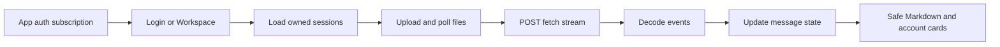

# React frontend

## 1. What this part does

The frontend lets a signed-in user work with owned chats, attachments and streamed answers. It displays server evidence and account strings rather than making banking decisions itself. Its authority comes from API responses; hiding a control in the browser is not an ownership check.
### Words used here

| Term | Plain meaning |
| --- | --- |
| React | React builds a screen from components whose output follows their current state. |
| Component | A component is a function that returns part of the interface. |
| TypeScript | TypeScript adds compile-time type checks to JavaScript before the browser runs it. |
| JSX | JSX is the markup-like syntax used inside React component code. |
| Hook | A hook is a React function that connects a component to state, effects or another React-managed capability. |
| State | State is data whose updates can trigger a component to render again. |
| Effect | An effect synchronizes a component with work outside rendering, such as a request or timer. |
| Ref | A ref holds a mutable value or DOM element without triggering rendering whenever it changes. |
| DOM | The document object model is the browser tree of page elements. |
| SSE | Server-sent events are named text events received inside one long HTTP response. |
| GFM | GitHub-flavored Markdown extends basic Markdown with features including tables. |
| Build | A build compiles and bundles source files into browser-ready static assets. |
| Proxy | A development proxy forwards selected browser requests to the backend during local development. |
| Mermaid | A text format that draws the flow diagrams shown in these documents. |

## 2. Where it lives

frontend/src/main.tsx mounts App and imports styles.css. App.tsx owns Login, Workspace, Notice, useCooldown and local event handlers. api.ts owns HTTP requests, authentication state and SSE decoding. Answer.tsx owns Markdown/citations and SourceDialog. AccountCards.tsx renders bank result display blocks. Icons.tsx contains local SVGs. limits.ts contains client checks and types.ts contains API/message declarations.

frontend/vite.config.ts sets the /app/ base and proxies /auth, /sessions and /chat to port 8000. frontend/tsconfig.json enables strict compilation and unused-name checks. package.json declares scripts/dependencies and package-lock.json fixes resolved versions. No external fonts, CDN scripts, web toggle, document selection sidebar or Mermaid renderer is added.

## 3. How it works, step by step

### Mount, login and authentication state

1. createRoot mounts App inside StrictMode. StrictMode adds development checks, including effect setup/cleanup behavior; it does not create a second backend or a second intended chat turn.
2. App subscribes to api auth state through useSyncExternalStore. The API module holds the token in memory and initializes it from sessionStorage when possible. setToken mirrors changes and notifies subscribers. A storage exception does not prevent memory-only operation.
3. Without a token, Login shows username/password fields and calls api.login with URLSearchParams. It does not put credentials in a JSON chat request or a VITE build variable. Successful login stores only the returned token and clears the password state as the screen changes.
4. Workspace loads me and sessions together. It opens the latest returned session and concurrently fetches its history and attachment list. A lifecycle AbortController cancels pending work on unmount, including logout.
5. The request helper adds the bearer header, uses credentials omit and handles HTTP errors centrally. An authenticated 401 clears memory/sessionStorage only when the request token is still the current token, avoiding a stale request clearing a newer login.

### State and effects

useState holds visible values: identity, chats, active chat, messages, file chips, draft, loading/uploading/sending state, progress text, error, retry deadline, mobile drawer, selected source and deletion candidate. useRef holds long-lived mutable controls: lifecycle/stream abort controllers, current active id, operation lock, message cache, file input, dialog, textarea and scroll container.

The operation ref prevents overlapping load/new/delete/upload/send actions from competing even before a state render disables controls. It is a client coordination measure, not a distributed lock or server idempotency key. The server still validates every request.

The bootstrap effect loads identity and chats and cleans up requests/cache. A processing-file effect polls immediately and then about every 1500 milliseconds while files process. Poll errors show a friendly message and wait five seconds or a stated retry time; 401/404 stops that polling path. Other effects resize the textarea, maintain conversation scrolling and synchronize the native delete dialog's open state. useCooldown updates a seconds-left display from an absolute retry deadline.

The mobile drawer uses CSS visibility as well as translation so hidden navigation is not left focusable offscreen. Source and delete dialogs use native dialog behavior. Labels, roles, keyboard focus outlines, scrollable tables and reduced-motion styles support basic accessibility. jsdom tests do not establish actual phone layout; the styles and any real-browser observation are separate evidence.

### Attach before send

1. The paperclip opens a file input restricted to the supported extensions. validateFiles checks at most three selected files, five chat slots, nonempty bytes, the public size limit and supported suffixes. A Retry action requires the same filename, but the server still checks its bytes/hash and ownership.
2. Local chips first say uploading. If there is no current chat, ensureSession creates one before uploading. FormData posts repeated files fields to that session's attachment endpoint.
3. The response can accept, reject or identify a duplicate per file. The UI merges returned doc_id values into chips and deduplicates existing IDs. Accepted processing chips trigger polling until ready or failed.
4. The composer blocks sending while files upload/process. Failed chips show a message and can be retried; locally rejected/failed submissions without a server ID can be dismissed. Already uploaded files cannot be individually removed because no such API exists.
5. send gathers unique ready IDs and posts session_id, message, attachment_ids and stream true. Failed files are excluded. It adds local user/assistant messages and clears the draft while waiting.

The API's actual per-file default is Settings.user_upload_max_mb=5. Frontend MAX_UPLOAD_MB derives from VITE_MAX_UPLOAD_MB, also default five; MAX_MESSAGE_CHARS derives from its matching VITE value. These are public build-time checks, not trusted enforcement. Match the size variable to USER_UPLOAD_MAX_MB if the backend is overridden. The retained backend MAX_UPLOAD_MB setting is not used by the user attachment route, despite the existing README wording.

### POST stream decoding and screen updates

The chat request needs a body and bearer header, so api.sendChat uses fetch rather than EventSource. readEvents uses TextDecoder in streaming mode to preserve UTF-8 characters split across byte chunks. It separately buffers incomplete lines, recognizes CRLF or LF separators, ignores heartbeat comments, joins multiple data lines, parses JSON and dispatches known event types. Network read chunks are not event boundaries.

status updates progress. meta attaches sources, account_cards and notes to the pending assistant message. token appends its t string, which can be an entire buffered account answer. done marks success and stores cited numbers. error becomes a visible failure with a retry countdown when its safe busy text includes one. A closed stream without done/error is an interrupted reply, not success. Unknown event types are ignored; malformed JSON or invalid token text is an error.

Stop aborts the stream. A generation failure keeps partial text visibly incomplete and restores the draft; the frontend never automatically re-sends that message. Session lists are refreshed after a completed request. Some local failed/incomplete turns will disappear when authoritative server history is reopened because the server never saved a completed answer.

### Evidence and account rendering

ReactMarkdown uses remark-gfm and skipHtml. A custom typed Markdown-tree plugin replaces numbered text references with internal links while skipping code, existing links, images and HTML nodes. The custom link renderer turns known sources into citation buttons; other links become inert text. Images are suppressed, so model-produced image URLs cannot load remote trackers through this component.

SourceDialog shows the source filename and location, using text if present or snippet otherwise. The live backend only sends snippet, up to 400 characters. Historical metadata has neither, so the dialog explains missing passage text. AccountCards renders balance strings, transaction amount strings and masked card status from the meta display block without doing arithmetic.

Workspace keeps a memory cache for live details while switching chats. It merges cached details only when stored role/content match at the corresponding message position. It does not write messages or cards to localStorage/sessionStorage. On a full reload that cache is gone, because the API did not save account cards/excerpts.

The UI coordinates requests and renders server results; ownership and bank reads remain backend responsibilities.

## 4. Key pieces

| Name | Kind | File | What it does | Why it exists |
| --- | --- | --- | --- | --- |
| App | function | frontend/src/App.tsx | Chooses login or workspace from the auth store. | Token state changes must immediately replace the protected screen. |
| Login | function | frontend/src/App.tsx | Submits the form and displays sign-in failures/cooldown. | Authentication has a separate screen and no implied public chat mode. |
| Workspace | function | frontend/src/App.tsx | Owns chats, files, message state, stream updates and dialogs. | One component coordinates this small application without another state framework. |
| Notice | function | frontend/src/App.tsx | Displays dismissible friendly alert text. | HTTP/upload failures need a readable shared presentation. |
| useCooldown | function | frontend/src/App.tsx | Updates seconds remaining from a retry timestamp. | A retry message should show when sending becomes available again. |
| useSyncExternalStore | library | frontend/src/App.tsx | Subscribes to api token changes. | Module-owned authentication state must drive React rendering reliably. |
| readEvents | function | frontend/src/api.ts | Decodes streamed bytes into known events. | UTF-8, JSON and event boundaries can split anywhere in fetch reads. |
| Answer | function | frontend/src/Answer.tsx | Renders GFM and citation chips with HTML skipped. | Untrusted model text must not be inserted as raw HTML. |
| SourceDialog | function | frontend/src/Answer.tsx | Shows the actual source excerpt or its absence. | A citation should be inspectable without inventing unavailable passage text. |
| AccountCards | function | frontend/src/AccountCards.tsx | Renders the service display blocks. | Authoritative formatted amounts should survive an answer-wording replacement. |
| Icon and Brand | function | frontend/src/Icons.tsx | Render local SVG shapes and the fictional wordmark. | The screen does not depend on external assets or icon/font CDNs. |

## 5. Decisions

| Decision | Because | Alternative not used | Trade-off |
| --- | --- | --- | --- |
| Keep the token in memory and sessionStorage | A tab refresh can resume login without putting credentials in persistent localStorage. | Use localStorage or a cookie-based backend session instead. | sessionStorage remains readable by page scripts; this backend does not implement cookie auth. |
| Parse fetch SSE directly | The endpoint is POST and named-event parsing is small enough to test locally. | Use EventSource or add another event-source client dependency. | The application owns framing, UTF-8, error and terminal-event correctness. |
| Render account display strings | The server already formatted integer money with its currency. | Recalculate amounts using JavaScript floats. | Formatting is less customizable, but keeps one authoritative representation. |
| Serve at /app/ | The existing API root must retain its Swagger redirect. | Replace the root route with the frontend. | Operators must build before starting the backend to register static hosting. |

## 6. What can go wrong

Differs from DESIGN.md: citation chips can open only the provided excerpt, not a full passage; saved history does not carry excerpts or account cards. The UI discloses both limitations.

Additional API boundary: there is no individual attachment removal route, so deleting a chat is the only uploaded-file removal workflow.

TypeScript interfaces do not validate every live JSON field. request/json casts JSON into expected types; readEvents explicitly checks parsed JSON and token text but not every meta shape. A severely malformed successful response can still cause a component failure. These are compile-time contracts plus selected runtime checks, not a full client schema-validation layer.

The browser error message may differ from the API detail: for example, HTTP 429 becomes Too many requests with its parsed countdown, and 404 becomes a generic chat/file unavailable message. A provider busy error arrives inside SSE and is displayed directly from the server's safe detail. Neither path logs the token.

## 7. How to see it working

Run npm test from frontend for the component/client tests and npm run build for strict TypeScript plus Vite output. These commands do not need live provider keys when tests stub fetch. The backend mounts frontend/dist under /app only when that directory exists at app import; restart after building.

Read frontend/src/App.test.tsx for upload-before-chat ordering, failed-file exclusion, owned chat creation/deletion and return to login on 401. Read api.test.ts for byte-by-byte event framing and Answer.test.tsx for HTML/image suppression. In a live demo, inspect the Network panel for the upload POST preceding the chat POST, but do not expose bearer headers. No fresh live browser/provider session was run for this documentation task.

## 8. Check yourself

1. **Why not use EventSource?** The real endpoint is POST with JSON/body and bearer headers; this client uses fetch streaming.

2. **Does TypeScript make a successful JSON response trustworthy?** No. Types are compile-time checks; runtime data can still be malformed.

3. **Why are ready IDs gathered immediately before sending?** Only completed files should be included, while failed files are excluded and processing blocks send.

4. **Why can historical account cards disappear?** They were never persisted by the API; the browser only retains live details in memory.

5. **What happens when an authenticated API call returns 401?** The current token is cleared from memory/sessionStorage and App renders Login.
