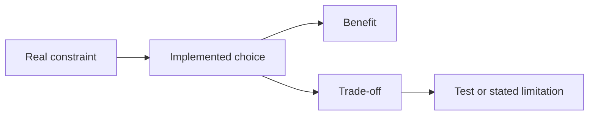

# Decision log

## 1. What this part does

This table connects major implementation choices to the project's privacy, quota and small-team constraints. It names alternatives that are not used and the cost of each current choice. The code confirms the choice; unless a reason is stated in comments or the plan, its rationale is an engineering interpretation rather than a recorded historical discussion.
### Words used here

| Term | Plain meaning |
| --- | --- |
| Trade-off | A trade-off is a benefit gained at the cost of another property. |
| Constraint | A constraint is a requirement or resource limit that narrows acceptable designs. |
| Boundary | A boundary separates responsibilities or authority that should not be freely mixed. |
| Runtime | Runtime means the period when the application is executing rather than being checked or built. |
| Quota | A quota is a provider-account allowance over a stated time or resource measure. |
| JWT | A JSON Web Token is the signed bearer credential used for authentication here. |
| Embedding | An embedding is a numeric text representation used for semantic matching. |
| SSE | Server-sent events are named text events within one long HTTP response. |
| Semaphore | A semaphore limits simultaneous access to shared capacity. |
| Transaction | A database transaction groups operations under an all-or-nothing consistency contract; this application does not use one for message pairs or deletion cascades. |
| Mermaid | A text format that draws the flow diagrams shown in these documents. |

## 2. Where it lives

Each row points to a source file and implementing symbol where the choice is visible. docs/DESIGN.md records intended decisions; this table follows current implementation when the two differ. The detailed behavior and failure limits are in documents 03 through 11. “Alternative rejected” in the table means an alternative absent from this implementation; a formal experiment comparing it is not confirmed from the code.

## 3. How it works, step by step

1. State the choice first. For example: identity is outside model tool schemas.
2. Explain the threat or cost it addresses: an untrusted model can invent a customer identifier, so bank authority must come from verified server data.
3. Name a specific alternative: ask the model to echo the right customer ID. Explain why that would move authority to an untrusted output.
4. State the cost of the current approach: handlers need a separate ToolContext and every service read still needs ownership filtering.
5. Identify its test or limitation. The schema test checks forbidden fields; live model wording can still be wrong even when the read boundary holds.

Use the same pattern for quota decisions. A small router and one final answer are a deliberate call budget, but a greeting still routes and provider retries can add attempts. A local semaphore reduces concurrency, but is not a distributed organization-wide quota controller. These distinctions prevent an interview answer from becoming a stronger claim than the code supports.

A useful decision explanation includes its cost and evidence, not just the selected library name.

## 4. Key pieces

| Decision | Why | Alternative rejected / not used | Trade-off | File and symbol |
| --- | --- | --- | --- | --- |
| Three evidence sources only | The bank demo permits shared policies, owned records and current-chat attachments, because outside facts break its stated scope. | Model general knowledge or web search. | Missing evidence produces refusal or support guidance. | app/services/llm.py — BANK_SYSTEM_PROMPT |
| One Python deployable application | A small team can operate one API and static frontend bundle. | Separate frontend and bank HTTP services. | Module boundaries are logical rather than independently deployable services. | app/main.py — app; frontend_dist |
| Frontend at /app/ | The root must preserve its existing Swagger redirect. | Replace the root route with the UI. | Build/start ordering and the subpath must be documented. | app/main.py — index; frontend_dist |
| React and Vite TypeScript | Components, strict compilation and a simple static build fit this interface. | A server-rendered Python page or a larger full-stack JavaScript framework. | The project maintains a separate npm toolchain. | frontend/src/main.tsx — createRoot; frontend/vite.config.ts |
| System fonts and local SVGs | The UI should work without remote font/icon assets or CDN calls. | Load external font/icon stylesheets. | Local appearance can vary slightly with installed system fonts. | frontend/src/styles.css; frontend/src/Icons.tsx — Icon |
| Own form login | Swagger and the browser share an explicit demo credential contract. | Public anonymous chat or an external identity-provider integration. | The application must maintain password/token/throttle logic. | app/auth/router.py — login |
| Argon2 password verification | Stored passwords should not be recoverable plaintext. | Plaintext or reversible password storage. | Hashing is expensive and needs threadpool handling on verification. | app/auth/security.py — password_hash; verify_password |
| Precomputed dummy hash | Unknown accounts still perform a password check, reducing an obvious timing clue. | Skip verification immediately for unknown usernames. | This reduces one leak signal without making timing perfectly identical. | app/auth/security.py — dummy_hash |
| HS256 short-lived JWT | A signed subject and expiry give a compact bearer credential. | Opaque server-session tokens or external OAuth login. | No individual revocation list or refresh-token flow exists. | app/auth/security.py — create_access_token |
| Reload active user per request | The current database record supplies the customer link and account status. | Trust arbitrary customer claims in a previously signed token. | Authentication requires an app database read. | app/auth/security.py — get_current_user |
| Generic login errors | Wrong, unknown and locked users should not expose account existence through different response text. | Separate unknown-user and wrong-password explanations. | The user gets less diagnostic detail. | app/auth/router.py — LOGIN_ERROR |
| Username throttle under one lock | Parallel attempts must not bypass the five-failure threshold. | Check counters without coordinating concurrent verification. | The shared lock serializes logins across usernames. | app/auth/throttle.py — LoginThrottle.attempt |
| 404 for foreign resources | Existence of another user’s chat/file is not disclosed through a distinct forbidden response. | Return 403 only when a foreign identifier exists. | Missing and foreign resources look the same to clients. | app/services/memory.py — require_session |
| Two database clients and database names | App writes and bank reads can use different Atlas permissions. | One unrestricted database connection for all data. | Operators must provision the actual credential separation. | app/db.py; app/bank/db.py — get_db |
| Integer bank money | Integer minor units avoid floating-point rounding of authoritative amounts. | Store monetary values as binary floats. | Currency scaling must be explicit; this formatter supports only INR. | app/bank/service.py — format_money |
| Masked account outputs | The model/browser need only a recognizable trailing number. | Return complete account or card numbers. | The customer has less identifying detail available in the chat. | app/bank/service.py — get_balances; get_card_status |
| Fixed fictional seed IDs | User/customer links and evaluation expectations must remain reproducible. | Generate unrelated customer IDs on each seed run. | Changing the seed contract requires coordinated evaluation updates. | scripts/seed_users.py — DEMO_USERS; scripts/seed_bank.py — CUSTOMER_IDS |
| Preserve existing demo users on reseed | A setup script should not reset a changed password or status accidentally. | Overwrite all user fields every run. | Rerunning the seed is not a password-reset operation. | scripts/seed_users.py — seed_users |
| Upsert stable bank seed keys | Repeated seed runs should restore demo rows without duplicating them. | Insert fresh accounts and transactions each run. | Rerunning restores values and may overwrite intentional demo modifications. | scripts/seed_bank.py — main |
| Shared library via explicit seed | Approved knowledge can be controlled without adding an admin role/UI. | Offer a global document-upload route to every user. | Updating shared policies requires an operator script. | scripts/seed_kb.py — seed_kb |
| Private files scoped to owner and chat | A file in one conversation should not become evidence in another person’s or another chat’s request. | One global user-upload library. | The same bytes can legitimately be stored in multiple scopes. | app/services/document_store.py — user_scope |
| SHA-256 scoped dedupe | Duplicate detection should avoid repeated work without revealing another scope’s upload. | Deduplicate globally by content hash alone. | Storage savings are limited to the same owner/session boundary. | app/services/document_store.py — register_document |
| Atomic attachment reservation | Concurrent uploads must not exceed five stored chat slots. | Count files and insert later without a reservation. | Failure paths must return a reserved slot. | app/services/document_store.py — register_document |
| Background in-process ingestion | The API can accept files before expensive embedding finishes. | Block upload until ready or require a separate worker queue. | Restarts can interrupt work; no durable job queue resumes it. | app/routers/attachments.py — upload_attachments |
| Located Section records | Evidence needs file structure and human-readable citation labels. | Keep only unlabelled plain text. | Loaders carry more metadata and format-specific rules. | app/services/loaders.py — Section |
| Recursive prose splitter | Paragraph/line/sentence boundaries preserve useful context better than arbitrary cuts. | Handwrite only fixed character slicing. | Chunk boundaries and overlap remain approximate. | app/services/chunking.py — chunk_sections |
| Atomic row groups and short slides | Headers and related values should remain together where possible. | Split every format identically. | Oversized atomic sections still split at a safety maximum. | app/services/chunking.py — ATOMIC_HARD_MAX |
| Table summaries | Row subsets alone cannot establish totals/counts over a table. | Ask the model to infer a dataset total from retrieved rows. | Statistics cover only rows read and summaries can themselves be truncated or not retrieved. | app/services/loaders.py — _summary_section |
| Header-enriched embedding text | Headings can improve matching while display text remains uncluttered. | Embed isolated clean chunks without breadcrumb context. | The processing path maintains two related string representations. | app/services/chunking.py — chunk_sections |
| 768-dimensional Gemini vectors | The configured embeddings and Atlas definition use the same reduced dimension. | Use a different dimension without rebuilding stored/search data. | Changing model or dimension requires compatible re-ingestion/index changes. | app/services/embeddings.py — _embed_batch; atlas/chunks_vector_index.json |
| Normalize vectors locally | The code explicitly normalizes reduced-dimensional output before storage/search. | Assume every returned vector is already unit length. | This is a numerical preprocessing rule, not proof of retrieval quality. | app/services/embeddings.py — _normalize |
| Batches of 50 with bounded retry | Ingestion requests and transient failures need finite provider work. | One unbounded request or infinite retry loop. | Large files require several sequential batches and may still fail. | app/services/embeddings.py — BATCH_SIZE; MAX_RETRIES |
| Ready-document vector gate | Deleted/replaced or unfinished document parents should exclude stale indexed chunks. | Trust every chunk currently present in the vector index. | Search performs an additional document lookup and sends permitted IDs. | app/services/retrieval.py — search |
| One OR-scoped search | Shared and current private evidence fit a single scoped query. | Run separate searches for each scope and merge. | The deployed Atlas filter/index capabilities must match the query. | app/services/retrieval.py — visibility_filter |
| Minimum document score | Nearest available text can still be irrelevant. | Always answer from any returned top result. | A high threshold can miss useful evidence. | app/tools/document_tools.py — documents |
| Native tool-calling router | A constrained function/argument interface is easier to validate than free text. | Parse an unconstrained prose plan or depend on model text instructions alone. | The app still validates every returned call and needs fallback logic. | app/services/router.py — plan_turn |
| Small separate planner model | Tool selection needs a shorter output than final answer wording under a free-tier budget. | Use the large answer model for every step. | A normal supported turn uses both model roles. | app/config.py — Settings.groq_rewrite_model; Settings.groq_model |
| Strict identity-free arguments | A malicious prompt must not choose another user/customer through tool parameters. | Trust the model to echo the correct customer ID. | The server supplies a separate immutable ToolContext. | app/tools/registry.py — Arguments; ToolContext |
| Plain handlers and bank services | Later orchestration replacement should not rewrite owned bank reads. | Import router/LLM/CrewAI into each handler. | The current orchestrator performs explicit planning/result combination. | app/tools/account_tools.py; app/bank/service.py |
| At most two data calls | Mixed questions need limited parallel work, not an autonomous unbounded loop. | Allow unlimited calls or iterative reasoning/tool cycles. | Questions requiring three different tools may receive incomplete coverage. | app/services/router.py — Plan; plan_turn |
| Parallel selected tools, one answer | Independent reads can overlap without paying for separate answer generation. | Run serially or ask a model to answer each tool result separately. | The orchestrator must handle partial success and merge evidence. | app/routers/chat.py — run_chat |
| Finite router validation fallback | Malformed selections should still search the permitted library safely. | Trust invalid calls or retry planning indefinitely. | Document fallback can miss an intended bank-account question. | app/services/router.py — plan_turn |
| Character token estimates | The small project avoids a provider-specific tokenizer dependency. | Add a full tokenizer stack and model-specific counts. | Estimates are approximate, so fitting reserves a margin. | app/services/prompting.py — estimate_tokens |
| Drop history before weaker evidence | Recent supported facts matter more than retaining all old conversation. | Truncate account data or arbitrary passage substrings. | Old conversation disappears from model input while remaining in saved history. | app/services/prompting.py — prepare_prompt |
| Separate input/output caps | Prompt consumption and generated response length use different controls. | Treat one token number as both limits. | The operator must understand both settings and provider quotas. | app/config.py — Settings.prompt_token_ceiling; Settings.answer_max_tokens |
| Shared Groq semaphore | Router calls and streams should not exceed local concurrency. | Allow every incoming request to call Groq immediately. | Extra calls can wait; capacity is process-local rather than distributed. | app/services/groq_runtime.py — groq_slot |
| Short rate retry only | Long waits and replayed visible text harm reliability and quota use. | Retry every rate error regardless of delay or emitted output. | Some failures surface as a busy message requiring a later request. | app/services/groq_runtime.py — call_groq; stream_groq |
| Literal fixed replies | Common safe outcomes need no large-model wording call. | Generate each greeting/refusal through the answer model. | The router call still normally happens and responses are less personalized. | app/services/llm.py — FIXED_REPLIES |
| Numbered citation filter | Models can emit valid facts in inconsistent reference styles. | Trust prompt instructions to guarantee reference syntax. | The filter validates markers, not semantic support. | app/services/citations.py — CitationFilter |
| Buffer account answer text | Currency checking must happen before wrong numbers are visible. | Stream account prose then attempt to retract bad values. | The user waits for complete wording while account cards can already appear. | app/routers/chat.py — run_chat |
| Exact currency-string guard | Authoritative display strings should not be reformatted or invented by generation. | Let the model calculate/reword financial values freely. | Allowed strings can still be semantically misassigned; unrecognized integers can escape. | app/services/output_guard.py — valid_account_amounts |
| Save after completed generation | Incomplete provider fragments should not become a finished stored answer. | Persist every streamed fragment as a completed message. | Delivery and the two message saves are not one transaction. | app/routers/chat.py — run_chat; app/services/memory.py — save_message |
| Content-free audit | Operational event tracking must not duplicate message text, balances or credentials. | Log prompts/results verbatim for debugging. | Less diagnostic detail is available and audit storage failures can still propagate. | app/services/audit.py — audit_event |
| Startup/hourly retention | Inactive private data should leave with its chat and interrupted processing needs recovery. | Keep all uploads forever or rely solely on TTL deletion. | Expiry is periodic and multi-collection cleanup can fail partway. | app/services/maintenance.py — purge_expired; retention_loop |
| Explicit CORS origins | Development origins can be allowed without permitting every web origin. | Use wildcard CORS. | Operators must keep intended deployment origins configured. | app/config.py — Settings.validate_origins; app/main.py |
| Fetch with explicit SSE parsing | Chat is POST with a body and token header. | Use browser EventSource GET semantics. | The client must handle byte framing, malformed streams and termination. | frontend/src/api.ts — sendChat; readEvents |
| Safe Markdown and inert external links | Untrusted generated text must not execute raw HTML or load remote images. | Use raw HTML rendering or load model-supplied image URLs. | Some links and rich content render only as text. | frontend/src/Answer.tsx — Answer |
| Memory token mirrored to sessionStorage | A tab refresh can preserve login while logout/401 clears local state. | Use persistent localStorage or change the API to cookie authentication. | Page scripts can still read the bearer token. | frontend/src/api.ts — setToken; frontend/src/App.tsx — App |
| Poll files before sending | The UI can show per-file progress and avoid requesting unfinished attachments. | Send immediately and always rely on the server wait. | Polling adds requests and failed files require a retry choice. | frontend/src/App.tsx — Workspace |
| Mock external dependencies in tests | CI should not need real credentials, quotas or Atlas availability. | Make every test a live provider call. | Tests do not prove live semantic ranking or model obedience. | tests/conftest.py; tests/test_phase6_integration.py |
| HTTP-only evaluation with phrase checks | Evaluation should survive agent-layer replacement without another judge-model cost. | Import application internals or call a judge model per answer. | Phrase checks can miss correct paraphrases or reward shallow matches. | scripts/run_eval.py — HTTPOnlyRunner; check_response |

## 5. Decisions

### Decisions you can defend with code

Owner filters and strict tool schemas are security boundaries. Prompt wording and query rewrites are model-guidance choices. Do not substitute one for the other: a more polite refusal does not make an unscoped database query safe, and a safe database query does not make every generated claim correct.

Resource controls also operate at different places. Upload caps bound a single file's ingestion. History/passage caps bound a single prompt. A semaphore bounds simultaneous Groq operations in one event loop. A rolling window bounds accepted chat starts per user. Provider quotas still apply to the whole external account and can be consumed by other programs.

The source shows no benchmark proving that another embedding model, vector database or framework would be worse. Explain compatibility and operational fit, then say “not confirmed from the code” if asked for comparative accuracy or cost measurements. Likewise, supporting later CrewAI replacement is a boundary constraint, not evidence that a migration has already been built.

## 6. What can go wrong

### Differences and choices that remain limitations

Differs from DESIGN.md: message persistence does not include account cards, live source metadata strips full text, and historical metadata strips excerpts too. The frontend therefore discloses missing restored details instead of introducing another backend endpoint. The /app/ production mount preserves the existing root redirect, consistent with DESIGN.md section 19.

The router's has_files value is computed from visible ready document names, including shared knowledge, not specifically from attachments on the new message. There is no deterministic keyword backstop that guarantees correct account-tool selection. Fixed replies avoid the answer call but not normally the planning call. These are current implementation facts, not open promises to change code during this documentation task.

Some useful production alternatives remain absent: durable job queues, distributed throttles, refresh/revocation tokens, transaction/replay protection for chat saves, an admin interface, real bank integrations and formal compliance controls. Their absence is not automatically a bug in a small fictional demo, but it sets the boundary of what the owner can claim.

## 7. How to see it working

For any row, open its named source symbol and follow one caller plus one relevant test. Good starting pairs are ToolContext with test_schemas_no_identity, prepare_prompt with test_40_messages_stay_under_ceiling, stream_groq with test_stream_rate_error_after_output_never_duplicates, and readEvents with frontend/src/api.test.ts.

If a decision concerns deployment credentials, provider limits or live indexing behavior, source inspection alone cannot confirm the deployed result. Read the operator configuration privately and run the relevant manual check yourself without copying secrets into documentation. No live comparison, quota measurement, seed run or evaluation was performed for this set.

## 8. Check yourself

1. **Why name an unused alternative at all?** It shows which problem the current choice solves and what property it gives up.

2. **Can you claim every reason was historically documented?** No. Some rationales are engineering interpretations of visible choices and project constraints.

3. **Why is a prompt instruction not an ownership boundary?** A model can ignore instructions; server-supplied identity and filtered reads enforce authority.

4. **Why keep the trade-off column?** It prevents “best library” claims and makes operational limits explicit.

5. **Is a future framework migration already implemented?** No. Plain handlers/services support future replacement, but the current native router remains in use.
